# Polarion 超级侧边栏

[](CHANGELOG.md)


**先看需求全景，再在需求旁边使用本地 AI；在同一份草稿里编辑，审阅后保存回 Polarion。**

面向工程需求编写与评审的 Windows 浏览器扩展。需求总览把整份 LiveDoc 铺成章节矩阵；独立富文本窗口与 AI 侧栏并排工作；正文、工程表格和画板保留各自的编辑方式；Claude Code 使用本机已有配置、Skills 与 MCP。

[安装与更新](#安装与更新) · [需求模板库](#需求模板库模板就是真实工作项) · [质量与闭环](#从发现到复验质量门禁与闭环) · [工作流与自动化](#工作流编排与自动化) · [驾驶舱与时间线](#驾驶舱命令面板与时间线) · [需求总览](#从需求全景开始) · [模型关联](#需求--simulink-模型绑定一次处处可用) · [富文本升级](#富文本升级markdown-输入公式与表格样式) · [变更管理](#变更管理把一次修改变成可回看的记录) · [变体](#同一需求多个变体) · [保存机制](#保存机制) · [验收与边界](#验收与边界) · [版本记录](CHANGELOG.md) · [GitHub Releases](https://github.com/suzike-dev/polarion-super-sidebar/releases)

**0.13.3 · Windows。** 这一版新增**需求模板库**：5 类必备模板（场景 / 计算 / 算法 / 状态机 / 混合）以真实工作项的形式存放在 library 项目，编辑体验与普通工作项完全一致；在正文光标处插入模板只需三步，写入的是副本，模板原件不变。同时修正了主题切换后侧栏品牌带的配色跟随。

[](docs/assets/readme-hero.png)

[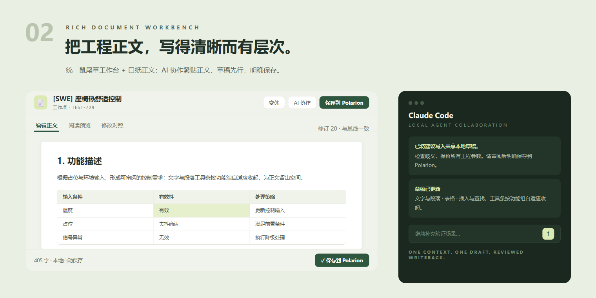](docs/assets/readme-workbench.png)

*按当前产品功能自绘，使用虚构示例；不是产品截图，不含真实项目、需求或对话信息。点击图片可放大。*

## 从需求全景开始

侧栏头部的网格按钮「软件需求分析总览」在**左侧文档区**展开章节矩阵，与「驾驶舱」入口并列。侧栏较窄时，「变更管理」「模型关联」「提案收件箱」收进「更多工作台」。总览里二级章是色带、三级分组是块、条目平铺。大分组按 18 项切块，无三级分组的整章多列铺开。

[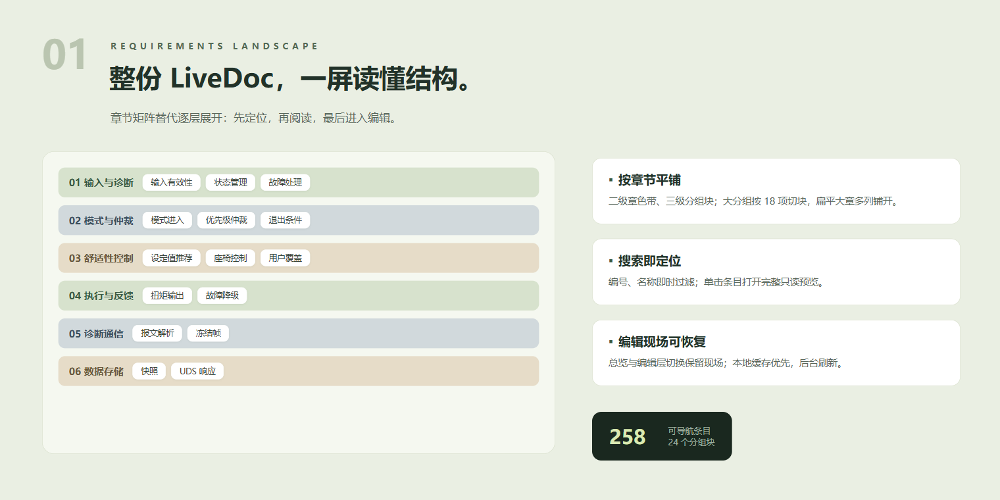](docs/assets/readme-landscape.png)

*自绘示意，使用虚构工作项；真实 SWR 文档实测 258 个条目、24 个分组块、零重叠。*

| 操作 | 行为 |
|---|---|
| 输入或 `Ctrl+F` | 搜索编号或名称，即时过滤 |
| 单击条目 | 打开完整**阅读预览**（只读） |
| 预览内「打开编辑工作台」 | 草稿和富文本就绪后进入编辑器。关闭编辑器回到来源列表，保留搜索词、已展开的详情和滚动位置 |
| 编辑中再开总览 | 关闭总览回到原先的编辑现场 |
| `Esc` | 先关当前层，例如从图片灯箱回到阅读预览，再回到总览 |

文档结构先用本地缓存打开，再在后台刷新。同项目的跨文档引用也可阅读，预览内提供「在 Polarion 中打开」。

## 需求 ↔ Simulink 模型：绑定一次，处处可用

工程需求最终要落到模型上。侧栏把「哪个需求在哪个模型模块里实现」变成项目级配置，一次绑定、团队共享、AI 直接可用。

**绑定模型目录。** 打开「模型关联」工作台，点「绑定模型目录」，选本地 SVN 里的模型根目录（如 `D:\Work\SVN\<项目>\04_Software\04_ASW_Code\ModelandCode`）。扫描器只读目录结构，按 `.slx/.mdl` 所在目录归并模块，并自动关联同名字典（`<模块>_DD.sldd`）与接口表（`<模块>_DD.xlsx`），识别 Simulink 工程文件（`.prj`）和根级公共字典。库模块默认纳入追溯，单元测试目录默认排除。同一个项目可为不同变体绑定多个根目录。

**每个工作项标注实现模块。** 项目绑定模型后，在本文档条目的阅读预览中点「标注」或「修改」。编辑器入口是标题栏的「实现模块」图标，角标显示已绑定的模块数。按模型根分组**多选**，点「保存备注」写入该工作项自己的附件。不同工作项可以分别标注，模块用相对目录名标识，换电脑、换 SVN 工作副本路径仍能找到。

**追溯矩阵。** 工作台「同步需求备注」默认按当前文档的大纲收集模块备注，构建本机索引。按模块展开可看关联的需求，也可查看未标注的需求，以及**一条需求都没有**的模块。点需求编号打开阅读预览。

**AI 直接可用。** 绑定后每轮会话自动带上模型概况（根目录、模块清单、字典/接口表路径、各模块已关联需求数），AI 可调用 `model_trace` 按模块反查需求、读写备注。于是你可以直接说：

- 「审查 TMS_HPMode 模块的实现和它关联的需求是否一致，找出缺失的降额逻辑」
- 「按模型现有接口表，把第 3 章的需求细化到信号级」
- 「哪些需求没有任何模块实现？列出来我判断是漏写还是没标注」

不再需要每次告诉 AI 模型文件在哪。深度接口校验（与 `.sldd` 逐项比对类型/单位/范围）仍由 Polarion MCP 的 MATLAB 工具完成；侧栏负责把路径与需求清单备好。

[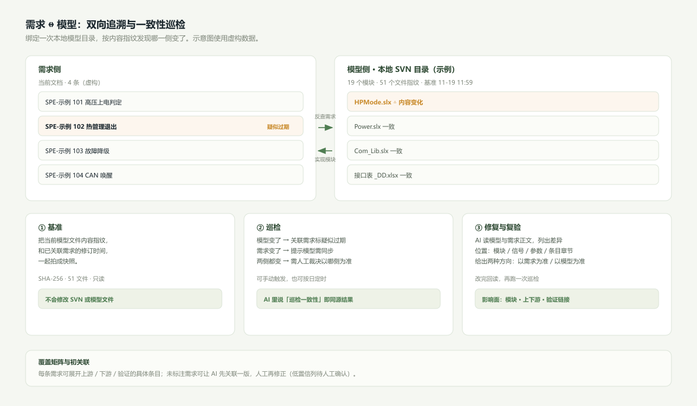](docs/assets/readme-trace.png)

## 富文本升级：Markdown 输入、公式与表格样式

编辑工作台对齐成熟文档工具的使用习惯，同时守住「写回 Polarion 仍是无损 HTML」这条底线——所有新能力都只增强渲染与输入，不会在原生视图里变成花屏。

**Markdown 快捷输入**（Typora / 飞书同款手感）：

| 输入 | 得到 |
| --- | --- |
| `# ` ~ `###### ` | 对应层级标题 |
| `- [ ] ` / `- [x] ` | 待办清单（可勾选） |
| `|信号|单位|` 后回车 | 按该行建表（自动表头 + 两行空行） |
| `$$Q = mc\Delta T$$` 后回车 | 块级公式 |
| 行内 `$T_{amb}$` 以 `$` 收尾 | 行内公式（美元金额等数字开头不触发） |
| `==重点==` | 高亮 |
| ``` 三个反引号 | 代码块 |

**粘贴 Markdown 自动转富文本**：从聊天、笔记软件复制的 Markdown 源文（标题/表格/列表/任务/代码/公式/高亮链接）识别结构后插入，而不是当纯文本堆进去；危险协议链接自动中和。

**代码语法高亮**：编辑器、阅读预览、AI 回答三处统一森林色主题，覆盖 C/C++/MATLAB/Python/JSON 等 40+ 语言（额外注册 MATLAB/Verilog/TCL）。高亮只存在于渲染层，写回 Polarion 的仍是纯 `<code>` 文本，原生视图干干净净。

**数学公式（KaTeX）**：行内与块级公式在侧栏内排版渲染，双击公式直接改 TeX 源码；Polarion 原生视图降级显示等宽 TeX 源码，内容不丢。AI 回答里的 `$..$` / `$$..$$` 也同步渲染。

**折叠块**：原生 `<details>/<summary>`，长内容（推导、备选方案、历史记录）收起不占版面；在 Polarion 原生视图不折叠时内容完整可读。

**表格一键样式。** 全框线 / **三线表** / 斑马纹 / 极简。光标在表内时对当前表套用，在表外时对全文表格套用。表头切换、行列增删移动、合并拆分、列宽行高、单元格底色与对齐都可单独调整。

**排版整理。** 在「插入与查找」点「排版整理」，可合并连续空段、按比例收窄超宽图片、给无边框表格补默认样式，并规范正文里的成对直引号、`0X` 前缀、多余空格和重复中文标点。空单元格和嵌套列表保留必要段落，已有表格样式、代码、公式和受保护宏保留原样。浮动提示列出各类改动次数，整次整理可撤销。

**其他**：提示块四色（信息/说明/注意/危险）；信号、状态、告警三种徽章一键插入；阅读预览图片点击灯箱放大。

## 从发现到复验：质量、门禁与闭环

整册体检按大纲读正文，生命周期门禁读项目覆盖索引。报告把两者并排展示，方便从发现一路追到工作项、改写和复验。

| 模块 | 入口 | 做什么 |
|---|---|---|
| 行内体检 | 编辑器状态栏「体检」 | 内置可验证性、原子性、明确性 6 条规则，加上项目词表和术语。行内高亮可悬停查看解释，在结果面板点「定位」跳到命中处。**0 发现**表示本地规则没有命中，还可点「AI 深检本条」核对判据和场景 |
| 术语替换与改写 | 体检结果中的「预览替换」或「AI 改写」 | 有标准术语建议时，先看工作项编号、全文匹配处数及「保存前」「保存后」，再点「确认并保存到 Polarion」。该条已有的草稿修改也会一并保存。没有标准替换词时，可交给 AI 改写本条草稿 |
| 整册体检 | 需求总览的体检图标 / 命令面板「整册体检报告」 | 按当前文档大纲读取最多 300 项的标题和完整正文，包括未保存的本地草稿。报告标明来源文档、时间和已检查/总数，正文读取失败的条目单独标记。点编号读正文，点「详情」看规则、命中原文、建议、门禁及关联条目。当前文档中有规则命中的可编辑条目可点「AI 改写」 |
| 规则中心 | 设置 →「质量规则」 | 查看启用数、来源和版本，在分类列表里逐条启停规则，编辑词表、提示语和术语别名。切换设置页签保留输入。手动调整或「恢复内置基线」后，点「保存到项目」更新共享规则包（PSB-RULES）。带着未保存的修改进入「AI 深度预审」时，会先提示是否放弃这些修改 |
| AI 预审 | 总览 / 命令面板「AI 预审评审」 / 规则中心「AI 深度预审」 | 进入评审台后点「发起 AI 预审」。会话产出阻断/重要/建议问题卡，可逐条选「已解决」或「忽略」，也可对当前文档的条目点「AI 按建议改」。点「发汇总」发送未决项 |
| 覆盖索引 | 模型工作台「覆盖视图」 | 按当前文档增量抓取正文摘要、双向链接与模块备注。点编号打开阅读预览，点「N 链接」展开上游、下游和验证链接，点链接可到 Polarion 查看对应工作项 |
| 写前查重 | 编辑器「写前查重」/ AI `dedup_search` | 与索引正文比对（中文二元组 + 信号名/参数），Top5 相似条目 + 重叠分 + 共享术语 |
| 影响前置卡 | 编辑器「影响分析」 | 实现模块（含巡检疑似过期）、上下游与验证链接、四道门禁实时判定、证据链导出 |
| 生命周期门禁 | 总览体检 / 影响卡 | 质量体检、验证准则、上游链接、实现模块逐项判定。「门禁策略」可启停各道门、设置发版提醒的质量分阈值。「门禁全过 N/M」统计项目覆盖索引中通过全部启用门禁的条目 |
| 工作项与链接事实 | 模型工作台 | 基准（内容指纹）→ 巡检（模型侧变/需求侧变/两侧冲突）→ 疑似过期标记；AI 初关联对未标注需求生成第一版备注，人工修正 |

[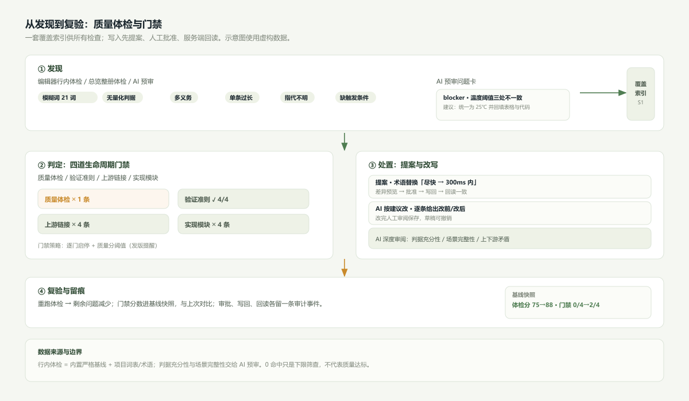](docs/assets/readme-quality.png)

## 需求模板库：模板就是真实工作项

5 类必备模板**以真实工作项的形式**存放在 Polarion 的 `library` 项目（Document Library）模板文档中，所有项目通用。添加扩展后首次打开模板库即自动安装，幂等；后续软件更新只在新版本里丰富内置模板，不会覆盖你的本地修改。

| 类别 | 适用场景 |
|---|---|
| 场景类 | 介入 / 退出型功能：开关、一键类、远程空调、模式请求等事件驱动场景 |
| 计算类 | 查表 / 公式型计算：目标出风温度、风量、水流量、过冷过热度 |
| 算法类 | 闭环 / 策略算法：PI / PID、MPC、前馈+反馈、仲裁打分等参数整定 |
| 状态机类 | 多状态跳转：上下电、充电、热管理模式、故障分级 |
| 混合类 | 复合逻辑：AUTO 空调、热源选择等同时涉及场景、计算与状态机的功能 |

每份模板都按同一结构组织，方便逐条评审：

1. **功能描述**（功能 ID / ASIL / 来源 / 优先级）
2. **输入接口表**、**输出接口表**（信号值、数据类型、有效范围、周期、超时、替换值、信号源）
3. **标定量表**（类型、默认值、范围、分辨率、单位、X/Y/V 轴定义、标定场合），正文中的标定量以琥珀色高亮并紧跟括号备注
4. **需求条目**（EARS 句式、独立编号、逐条可验证）
5. **功能定义 / 时序汇总 / 异常降级 / 验证准则（追溯矩阵）/ 开放问题**

[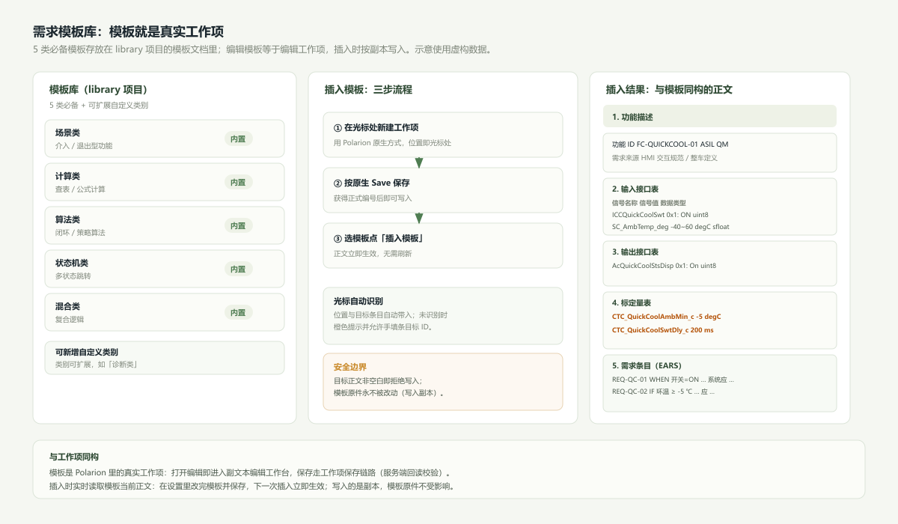](docs/assets/readme-templates.png)

*自绘示意，使用虚构数据；正文结构与变量命名对齐工程规范（模块前缀_对象_属性[Act|Des]_类型后缀）。*

**在哪用、怎么用**

| 入口 | 操作 |
|---|---|
| 设置 → 模板库 | 查看 5 类模板与使用时机；「打开编辑」进入副文本编辑工作台，「恢复标准」还原内置版；「新建模板」在模板库里新建一个工作项；可新增自定义类别 |
| 正文顶部「插入模板」 | 插入到已有工作项：① 在光标处用原生方式新建工作项 → ② 按原生 Save 保存 → ③ 选模板点「插入模板」。位置与目标条目自动识别，正文立即生效，无需刷新 |
| 设置 → 模板库「参考模板」开关 | 开启后，AI 新建工作项或改造已有需求时，按匹配类别的模板组织正文 |

**几条硬规则**

- 模板是工作项：编辑与保存走同一条链路（服务端回读校验），不存在第二套编辑器
- 插入写的是**副本**：新条目编号按目标项目规则生成，名称可自定义或自动生成，模板原件永不被改动
- 目标正文必须是空白：已有内容会拒绝写入，避免覆盖
- 插入时实时读取模板当前正文：设置里改完保存，下一次插入立即生效

## 工作流编排与自动化

从 AI 助手会话栏的工作流图标，或命令面板「工作流与宏」进入。「设计」里管理流程和宏，「运行轨迹」里查执行结果。「运行」「拆解并执行」「重放」在 Host 接受后打开对应会话，启动失败可在原面板查看原因、保留输入再试。

| 能力 | 说明 |
|---|---|
| 顺序流 + 检查步 | 「查看步骤」可读每步提示词、附加指令、暂停点和返工目标。检查步末行给出 `【结论:PASS】`、`【结论:FAIL】` 或 `【结论:NEED_MANUAL】`。FAIL 回到指定的更早步骤返工（上限 1–5 次），证据不足、缺少结论或耗尽次数时暂停等人工处理 |
| 目标驱动拆解 | 在「说出目标」填入任务，点「拆解并执行」，或在对话输入 `/wf::目标`。结果出现在「动态拆解」，可点「保存复用」命名。下次从定义行点「运行」，也可输入 `/wf:名称 附注` |
| 内置工程模板 | 点「安装内置模板」加入需求三连审、模型一致性巡检、写前查重合并、体检清零、新需求起草 5 个流程 |
| 运行轨迹 | 本项目最近 20 次运行可展开「步骤与结果」，逐步查看状态、结果摘要和返工次数。有对应会话时点「查看会话全文」，旧记录也能读已有的步骤摘要 |
| 每日定时 | 工作流和宏都可点「定时」，选本地时间 `HH:mm` 后点「保存定时」，计划绑定当前文档，当天去重。已有计划可点「取消定时」 |
| 批量运行 | 已保存的工作流点「批量」，填入工作项编号后点「开始批量」。相同编号合并，最多 10 项，各自开独立会话并带上运行附注。回执里点编号进入该会话，或点「查看运行轨迹」 |
| 宏 | 填宏名称和最近指令数（1–10），点「录制」。展开「查看指令」核对普通指令原文，再点「重放」，也可设每日定时 |
| 异常恢复 | Host 重启时，被打断的步骤转暂停。评审或分诊的运行记录失去对应任务后会标为失败，可重新发起 |

[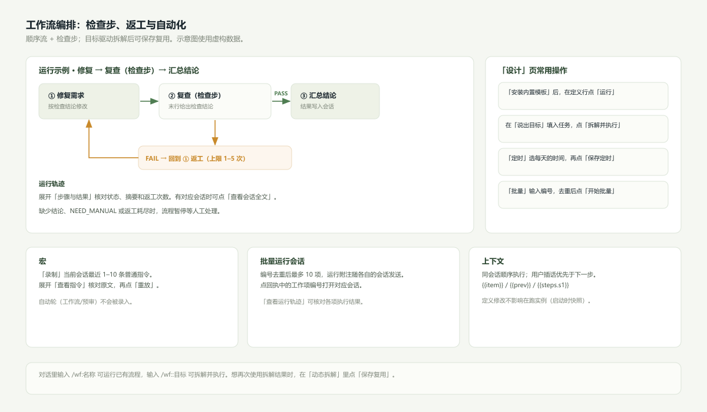](docs/assets/readme-workflow.png)

## 驾驶舱、命令面板与时间线

**驾驶舱。** 每张指标卡都能点开。关闭从卡片打开的明细，会回到驾驶舱刚才的指标。体检还没有报告、覆盖还没有索引时，对应卡片显示「—」。点「保存快照」可记录当时的指标，与上一份快照比较。

| 指标卡 | 数字怎么算 | 点开看什么 |
|---|---|---|
| 待审批提案 | 当前文档里可由收件箱直接审批的待处理提案。工具审批和工作流暂停由所属任务处理 | 收件箱的可审批列表，可切到「查看全部提案」 |
| 守望警报 | 本项目警告级别的守望警报 | 收件箱「动态与警报」里的警告明细 |
| 体检发现 | 项目最近保存的整册报告中，已检查数减去通过数。同条多处命中只计一项，正文读取失败也计入 | 原报告的来源文档、检查时间和条目。需要检查当前文档时再点刷新 |
| AI 预审未决 | 在项目最近 20 次预审中，只统计「待处置」记录里仍未决的问题卡 | 评审台，已勾选「只看未决问题」 |
| 孤立条目 | 项目覆盖索引中，上游链接、实现模块、验证链接三项都为空的条目数 | 模型工作台「覆盖视图」，已勾选「只看孤立条目」 |
| 工作流 | 本项目的工作流定义数，含动态拆解和已保存的定义 | 工作流「设计」页的「工作流定义」区 |
| 工作集 | 本项目已保存的动态查询数 | 当前驾驶舱内的「智能工作集」 |
| 项目事件（近500条） | 本项目最近最多 500 条事件 | 收件箱的项目事件流，可展开更多记录 |

- **统一收件箱。** 「待审批」可查看差异、拒绝或「批准并应用」。「动态与警报」包含守望警报、晨报、会议纪要分诊和项目事件流。「时间线」按时间倒序查看项目最近 400 条事件，正在编辑工作项时只看该条目的记录。
- **智能工作集。** 每次展开时读取最新数据。「覆盖缺口」「孤立条目」「关键词」查询项目当前的覆盖索引，上游、实现模块、验证三项中任一项为空就算覆盖缺口。「体检有发现」取项目最近保存的整册报告，列出有规则命中或正文读取失败的工作项。
- **命令面板。** 点头部放大镜或按 `Ctrl+Shift+P`，可直达整册体检、AI 预审、会议纪要分诊、工作流等入口。输入至少 2 个字符可搜工作项，以 `/` 开头只筛命令。用 `↑` / `↓` 选择、`Enter` 打开、`Esc` 关闭。浏览器将按键交给页面时也兼容 `Ctrl+K`。
- **证据链导出。** 编辑器「影响分析」可把本条的实现模块（含疑似过期）、上下游/验证链接、历史轨迹导出为 Markdown，用于评审与交接。

[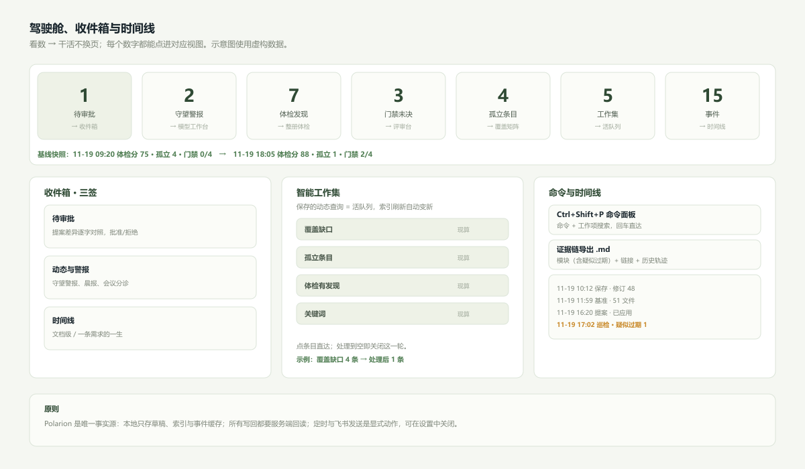](docs/assets/readme-cockpit.png)

## 变更管理：把一次修改变成可回看的记录

从侧栏头部打开「变更管理」工作台。修改前点「设定基准」，系统把此刻整篇文档写入当前 Polarion 项目。期间可多次保存，改完点「结束并生成」才逐项对比并生成记录。忘了点基准，可从最近变更时间线里选「对比这次」，或任选前后基准补建。

[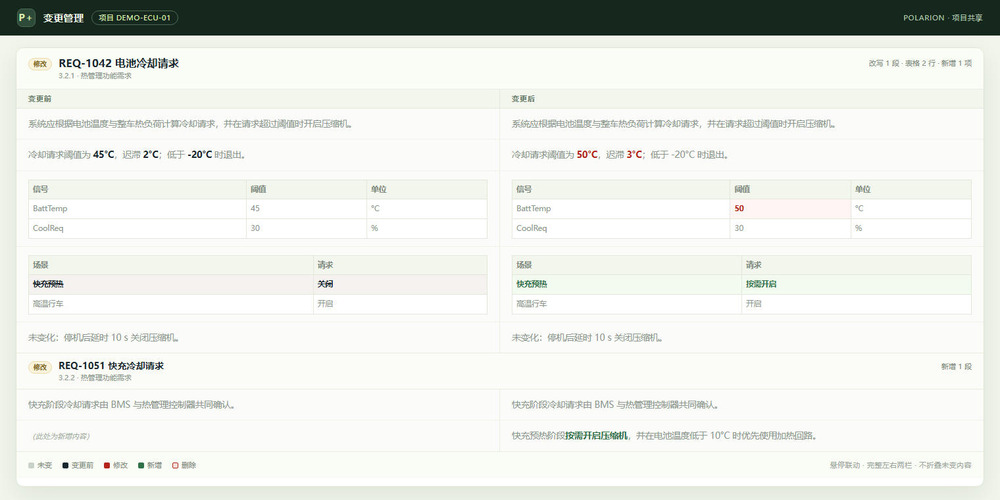](docs/assets/readme-change-diff.png)

*自绘示意，使用虚构项目与需求内容。*

每个变更工作项固定左右两栏：左栏完整变更前、右栏完整变更后；未变化的段落与表格也完整保留并灰显。变更前黑色加粗（纯删除加删除线）、变更后修改红色加粗、纯新增绿色加粗；悬停变更片段，两侧对应位置联动描边并浮出原文/新文。表格按行与单元格比对，未变行灰字白底，变化单元格与新增/删除行着色。

[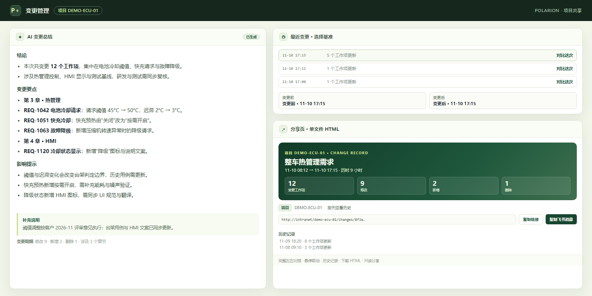](docs/assets/readme-change-share.png)

*自绘示意，使用虚构项目与需求内容。*

| 能力 | 行为 |
|---|---|
| 基准与结束 | 显式设定基准；结束才生成记录；可取消基准并清理快照 |
| 时间线补建 | 聚合工作项更新与历史 revision；选“最后一次/上上次/今天开始”即可，不手写时间 |
| 完整对照 | 左右两栏完整内容；未变灰显；块/词级 + 表格行/单元格级高亮；悬停联动 |
| AI 总结 | 结论 → 按章节的变更要点 → 影响提示；可重新生成，失败保留自动摘要 |
| 人工补充 | 补充“为什么改、影响谁”；与 AI 总结一起写入项目记录 |
| 记录存储 | 每次变更一个 Polarion 项目工作项 + 压缩附件；按项目隔离，项目成员共享 |
| 变更历史 | 记录名直接列出变动工作项的编号与标题；鼠标悬停即可预览变更要点、工作项与总结，单击进入完整逐项对照 |
| 分享 | 飞书群机器人直发交互卡片（项目可配多个群、支持签名校验）；杂志式排版（文档标题题头 + 四格关键数字 + 灰底总结引用块 + 单一主按钮），「打开变更详情」直接跳到侧边栏里的这条记录；未安装插件的浏览器落在记录工作项页并提示安装；另保留内网分享页、复制文案与单文件 HTML 下载 |

**记录不落在个人电脑上。** 基准快照、最终记录、AI 总结与补充说明都写入当前项目的 Polarion 工作项和附件；本机只缓存列表与正文，换电脑或换人后读取同一份项目记录。记录顶部与分享页顶部都会标注所属项目。

### 分享到飞书

变更工作台右上角的纸飞机是「飞书推送群」入口：在飞书群里添加自定义机器人，把 webhook 填进来，可加群备注名、可填机器人签名密钥，点「发送测试卡片」确认连通，再「保存到项目」。一个项目可以配多个群；配置写入项目的 `PSB-FEISHU` 工作项附件，**项目里任何人保存后，其他成员无需再配**。

点「分享到飞书」时：先把这条记录渲染成单文件对照页，作为 HTML 附件写进记录工作项，再向该项目全部群发送交互卡片。卡片按杂志版式组织：题头是文档标题与项目，副标题标注「需求变更速览」；正文先给变更工作项/修改/新增/删除四格关键数字，再是变更区间；AI 总结放进灰底引用块，小节用绿色竖条标题分隔；最底部只有一个「打开变更详情」按钮。

按钮不再指向附件下载地址，而是记录工作项页的变更详情深链。**已安装插件**的浏览器会立刻切到文档页，侧栏展开这条变更的逐项对照；**未安装插件**的浏览器留在工作项页，正文顶部会说明需要安装插件，并给出下载入口。完整对照快照仍随记录存为工作项附件，可手动打开。任一发送环节失败会在工作台提示具体群与原因，并回退到「复制飞书文案」。

## @ 引用工作项，单击即读

编辑器正文和对话输入框都支持 `@`，中文紧邻 `@` 也能触发。两处都优先列出本文档的匹配项，按编号去重。编辑器可按编号或标题筛选，最多显示 300 条，选中后插入 Polarion 原生引用，保存后仍可点击。聊天最多显示 60 条，选中后把工作项编号填进消息。编辑器、已发送的消息和原生正文里的引用，**单击**即可打开完整阅读预览。

[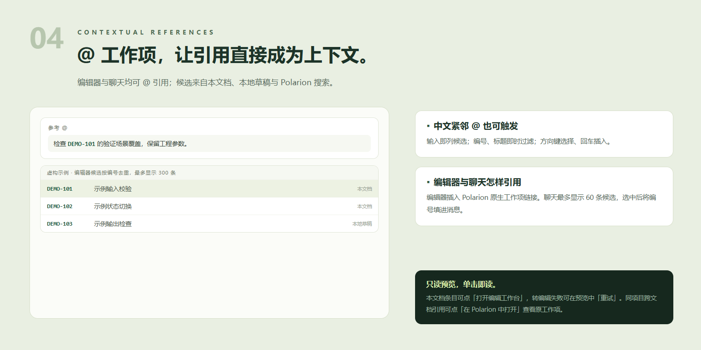](docs/assets/readme-references.png)

*自绘示意，候选来源：本文档 → 本地草稿 → Polarion 搜索。*

阅读预览优先显示本条尚未同步到 Polarion 的本地修改。本文档条目可点「打开编辑工作台」，同项目的跨文档引用只提供正文阅读和「在 Polarion 中打开」，模块备注在归属文档维护。

读取另一条正文或切到编辑器失败时，原预览保留，并显示工作项编号、失败原因和「重试」。请求等候中也可取消，关闭预览后迟到的结果不会重新弹窗。若已进编辑器但正文载入失败，可点「重新载入」或「阅读原始正文」。

## 同一需求，多个变体

主工作项保持文档槽位稳定；变体是 Polarion 项目里的**独立工作项**，通过可配置链接角色关联，需要时再接入主正文。

[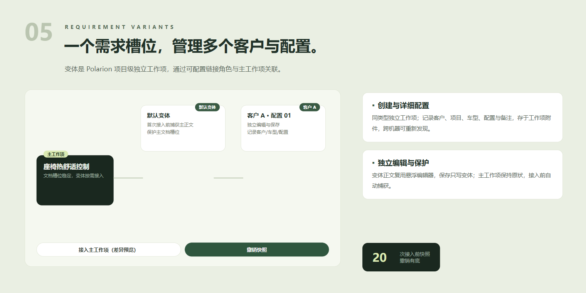](docs/assets/readme-variants.png)

*自绘示意，客户、项目与车型均为虚构。*

| 能力 | 行为 |
|---|---|
| 新建变体 | 同类型独立工作项，可复制主正文；详细配置存入工作项附件 |
| 默认变体 | 主工作项默认显示为「默认」；首次接入前先捕获成独立默认变体 |
| 编辑变体 | 复用悬浮编辑器；保存只写变体，不触碰主工作项 |
| 接入主工作项 | 差异预览、并发校验、画板快照复制、图片重新绑定、独立回读 |
| 撤销 | 保留最近 20 次接入前快照 |
| 跨机器 | 列表、配置与接入状态随 Polarion 链接与附件保存 |
| 解除 | 只删本地归属与链接，工作项本身保留 |

安全边界：只操作已登记并通过回读确认的变体；服务端写入仍走本地草稿 + 明确保存。

## 把空间留给正文与表格

「文字与段落」「表格」「插入与查找」各占一条功能行；空间不足时按名称收起功能组。编辑器提供标题段落、列表待办、提示块、代码块、链接、图片、查找替换与内容块移动复制；工程表格支持选区、行列增删移动、合并拆分与精确属性。受保护宏显示为紧凑 chip，保存原样写回。

**AI 原子编辑工具（0.12.0）**：改一块、改整篇都不再整篇读写——

| 工具 | 用途 |
|---|---|
| `edit_block` | 段落↔标题↔列表互转、插入、删除、移动、拆段、合段、列表项提升；按块内唯一文字定位，受保护对象块拒绝删除/移动 |
| `restyle_document` | 编号段落→标题层级（`headingLevelOffset` 可调）、统一行距/对齐、清理空段 |
| `replace_all_text` | 全文逐字替换（可选大小写），保留格式/表格/图片/受保护对象，返回替换次数 |
| `create_work_item` | 在当前 LiveDoc 新建工作项（不再生成游离工作项），内容随后写本地草稿 |
| `peek_work_item` | 同项目跨文档只读参考标题与正文前 1200 字，不产生草稿 |
| `edit_table` / `read_table` / `update_table` | 表格清单、建表/删表/增删行列/列宽一次批量；合并单元格表单表手术 |

配合「修改类工具只回摘要」与每轮快照截断，建表类任务实测 15 秒、块操作一轮几十秒完成，上下文消耗降一个数量级。

**原生正文宽度可调**：Polarion 页面中间那篇“纸”默认只有 754px，宽屏两侧留白。设置 → 外观 → 原生正文宽度，三档即时生效：默认 754 / 加宽铺满（默认）/ 自定义像素（600–2560，居中）。只改显示，不影响服务端内容。

[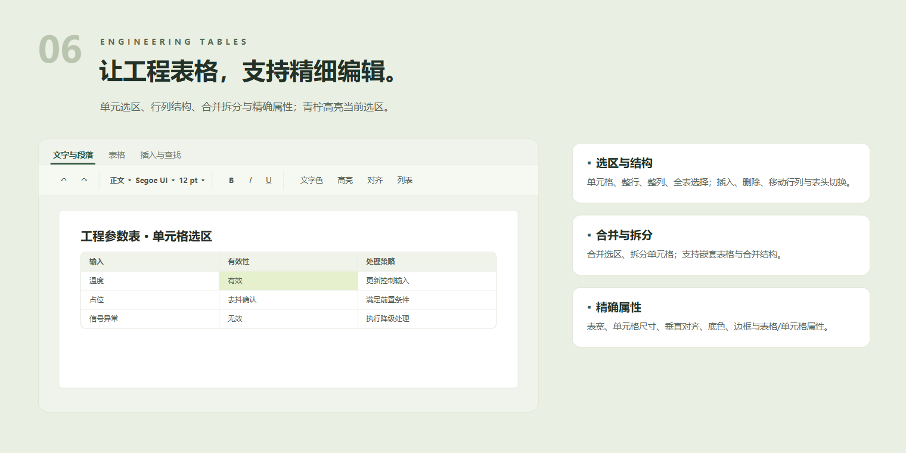](docs/assets/readme-toolbar.png)

*自绘示意；布局验收覆盖 1440–390px × 三组工具栏。*

## 从需求描述到可编辑配图

[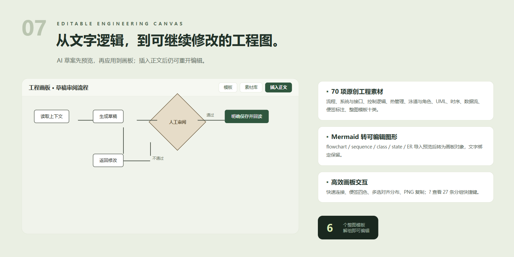](docs/assets/readme-board.png)

*自绘的虚构审阅流程，展示预览与可编辑图形能力。*

画板内置 **70 个原创工程素材**（流程、系统接口、控制逻辑、热管理、泳道、UML、时序、数据流、便签、整图模板十类）与 6 个整图模板。

| 能力 | 行为 |
|---|---|
| AI 整图 | flow / swimlane / sequence / class / er；草案先预览再应用，插入正文只改本地草稿 |
| 模板中心 | 6 个整图模板，缩略图预览后插入并选中 |
| Mermaid | 粘贴定义转可编辑图形，`Ctrl+V` 直接进入导入预览 |
| 快速连接 | 主菜单或 `C`，点起点→点目标自动连线 |
| 便签与对齐 | 一键便签、四色切换、多选对齐/分布 |
| 复制图片 | PNG 复制到系统剪贴板 |
| 快捷键 | `?` 打开 27 条分组快捷键帮助 |

生成器校验画幅、重叠、遮挡与连线穿越；放不下时返回布局提示，要求拆图而不是生成坏图。

## 保存机制

**编辑器默认自动保存本地草稿，点「保存到 Polarion」写回正文。** 体检替换在差异预览中单独确认。AI 修改后自动写回由设置里的专用开关控制，详见下方「会话效率与指令」。

关闭编辑器时若本地同步失败，当前输入会先备份。重开同一条目可点「恢复编辑」，按原草稿修订恢复到本地，再审阅保存。遇到修订冲突时备份仍可「导出备份」。

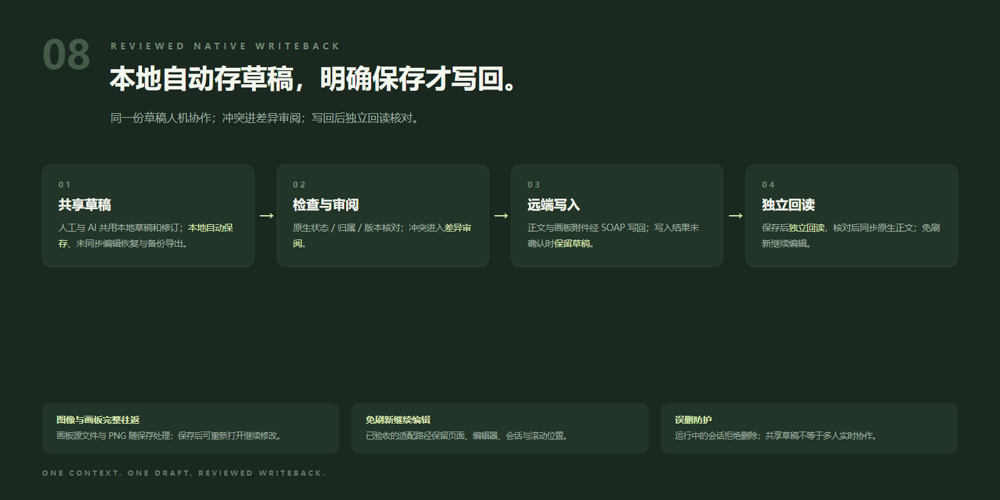

保存前检查原生编辑状态和工作项归属。保存以工作台当前正文为准覆盖服务端，排版整理、人工修改和 Agent 改写走同一条路径；写后确认服务端已是这份内容，再同步当前 LiveDoc。原生文档只显示标题的条目，会分别核对工作项描述和页面标题。服务端确认写入但原生页面同步失败时，编辑器分别提示两个结果，保存本身仍然成功；服务端仍是旧内容时提示未应用，草稿完整保留，可直接再次保存。

免刷新保存严格匹配已验证的 Polarion 21R2 构建；其他构建在远程保存前停止，需完成适配与验收。[保存与原生交替编辑验收](docs/整体精修与富文本验收_20261104.md) · [大型 LiveDoc 修复记录](docs/v0.2.6大文档保存修复.md)

## 会话效率与指令

[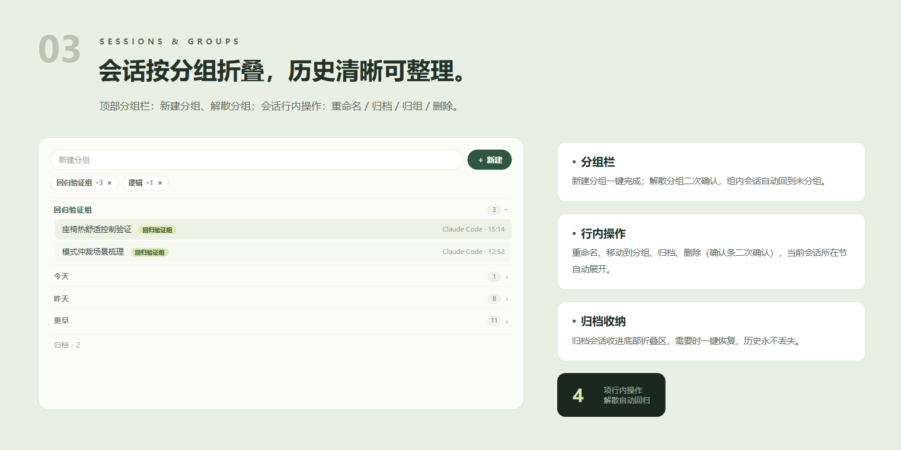](docs/assets/readme-sessions.png)

[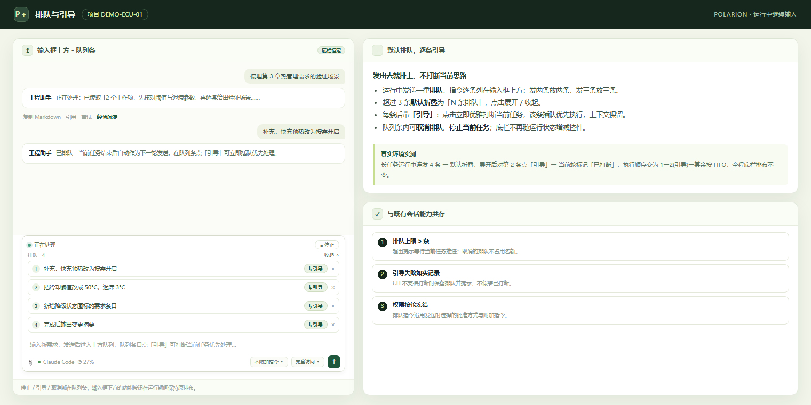](docs/assets/readme-queue.png)

- **会话历史整理（0.6.0 新增）**：会话支持重命名、移动到分组、归档与删除（删除需二次确认；运行中的会话拒绝删除）。顶部分组栏新建/解散分组（二次确认，组内会话回到未分组）；列表按分组折叠展开，默认展开当前会话所在节。
- **批准方式**：默认“自动批准”；可切“请求批准”或“完全访问”，任务开始时固定本轮权限。
- **运行中继续输入（0.9.0 队列条）**：发送一律排队（最多 5 条），指令逐条列在输入框上方；每条「引导」优雅打断当前任务并插队优先，可取消排队；停止按钮在队列条内；超过 3 条默认折叠。输入框下方功能栏运行期间排布不变。
- **预设指令**：分「随发送附加」与「通用指令库」；每条可挂多个本地文件，使用时重新读取。
- **省 token 与原子编辑（0.11.0–0.12.0）**：修改类工具（replace_text / update_rich_document 等）只返回摘要不回显全文；每轮自动注入的长工作项快照超过 1.2 万字符自动截断（精确选区原样保留）；表格、块结构、整篇排版与全文替换都有专用小命令，见[把空间留给正文与表格](#把空间留给正文与表格)。
- **AI 修改后自动保存（0.12.0）。** 设置 → 常规的开关默认关闭，普通会话只修改本地草稿。开启后，普通会话完成或被引导打断时，会把改过的草稿写入 Polarion 并回读，在回答末尾说明结果。体检的「AI 改写」和预审的「AI 按建议改」仍由你审阅草稿后保存。「AI 深检本条」要求保留原文，在会话里给出检查结果。
- **消息操作**：复制 Markdown、引用选中片段、同样请求重试、经验沉淀；长会话挂载最近 40 轮。
- **设置持久化**：字号 9–18px、原生正文宽度、共享草稿文件夹、指令增删改、Polarion 账号连接。

[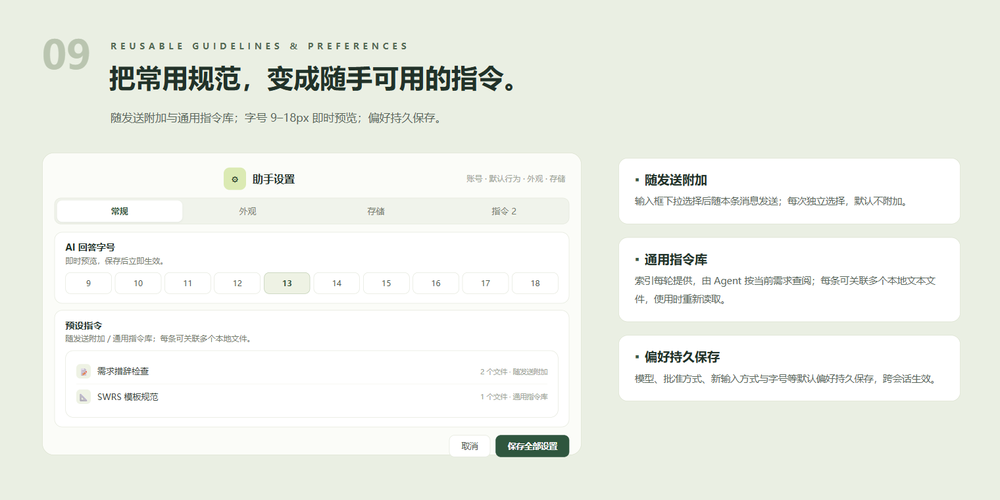](docs/assets/readme-settings.png)

## 经验沉淀：记住每一次纠正

回答下方「经验沉淀」把本次会话里你明确纠正、否定或确认的做法提炼成条目，与已有经验合并去重后按项目存到本地 `experience/<项目>.md`；之后每轮对话自动注入「历史经验沉淀…必须遵循，避免重犯」。会话栏灯泡入口随时查看，独立浮窗支持编辑与清空（二次确认），再次沉淀自动合并。

[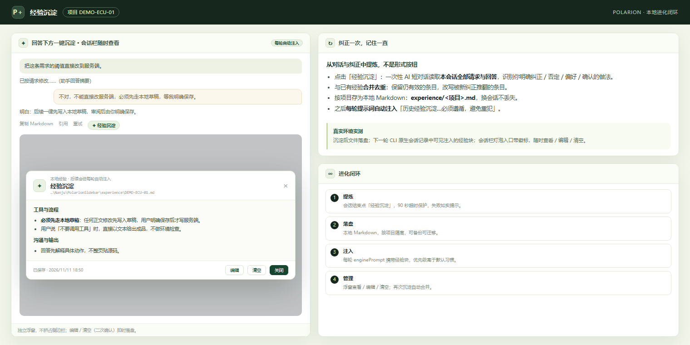](docs/assets/readme-experience.png)

*自绘示意；真实环境实测沉淀落盘后，下一轮 CLI 原生会话记录中可见注入的经验块。*

## 本机与服务端如何协作

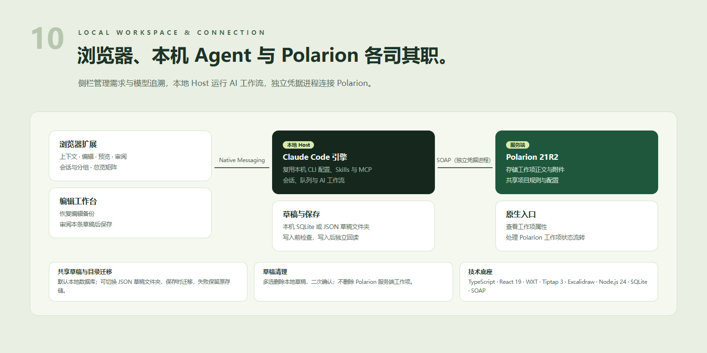

浏览器负责上下文、编辑与审阅；本地 Host 负责会话、草稿、Agent 运行和保存编排；Polarion 承载正文与附件。模型请求按本机 Claude Code 配置发送，不表示离线推理。

<details>
<summary><strong>技术栈、数据位置与目录</strong></summary>

| 部分 | 实现 |
|---|---|
| 浏览器扩展 | TypeScript · React 19 · WXT · Shadow DOM |
| 内容编辑 | Tiptap 3 · Excalidraw · 源 HTML 映射 |
| 本地 Host | Node.js 24.22.2 · SQLite · Native Messaging |
| 协议与状态 | Zod 校验 · 上下文快照 · 草稿修订 · 运行事件 |
| 变更管理 | 块级 LCS · 词级 diff · 表格行/单元格 diff · Polarion 项目记录 |
| Polarion 连接 | 独立凭据进程 · SOAP 读写 · 保存后独立回读 |

会话、草稿与项目目录默认位于 `%LOCALAPPDATA%\Nanju\PolarionSidebar`；凭据走 Windows DPAPI 加密，只进入独立 Polarion 进程，不传入 AI 引擎。共享草稿文件夹里的其他 JSON 不会被当作草稿。

```text
apps/extension/          侧栏、富文本、需求总览与画板
apps/host/               Agent、草稿、变体与保存服务
packages/core/           HTML、差异、画板、引用与格式逻辑
packages/protocol/       校验协议与共享类型
packages/polarion-soap/  SOAP 适配器与上游许可证
scripts/                构建、安装、版本与开发探针
docs/                   规格、验证报告与自绘功能示意图
```

</details>

## 安装与更新

当前交付方式是**源码开发安装**，请选择自己有写权限的固定本地目录；已验证路径包含中文和空格的安装。GitHub Release 自动提供的源码压缩包不是可直接加载的扩展包；图形安装器与自动更新尚未交付。UNC 网络目录、超长路径和只读安装目录尚未验收。

### 环境准备

| 条件 | 要求 |
|---|---|
| 系统与工具 | Windows x64、Git、现有 Node.js 20.11+（20.x）或 22+ 与 npm，仅用于引导；Windows PowerShell、.NET Framework 4 编译器。后续安装、检查及运行使用项目私有 Node 24.22.2，无需把全局 Node 固定为 24 |
| 浏览器 | 可加载本地 Chrome MV3 扩展。既有浏览器验收使用 Ego，Chrome/Edge 的完整矩阵仍待验证 |
| Claude Code | 本机已安装并认证；自动发现 PATH、原生安装或 npm 安装，可显式指定 CLI 路径 |
| Polarion | 当前适配的公司 21R2 实例及自己的账号/访问令牌；可独立配置本工具凭据，不要求先安装某个 MCP |
| Skills 与 MCP | 使用自己的配置；Diagram Design 原文与许可证已随产品提供，其它外部能力按需配置 |

### 首次安装

以下命令适用于 0.13.3 源码。按发布版安装时，先在 Releases 确认目标 tag 已发布，再克隆并切换版本。已有该版源码的开发工作区可直接从 `node scripts/setup-runtime.mjs` 开始。复现旧版请遵循对应 tag 自带的 README。[GitHub Releases](https://github.com/suzike-dev/polarion-super-sidebar/releases)

```powershell
git clone https://github.com/suzike-dev/polarion-super-sidebar.git
cd polarion-super-sidebar
git switch --detach v0.13.3
node scripts/setup-runtime.mjs
$node = '.\.runtime\node-v24.22.2-win-x64\node.exe'
$npmCli = Join-Path (Split-Path (Get-Command npm.cmd).Source) 'node_modules/npm/bin/npm-cli.js'
if (!(Test-Path -LiteralPath $npmCli)) { throw '请将 $npmCli 设置为已安装 npm 的实际 npm-cli.js 路径。' }
& $node $npmCli ci --ignore-scripts
& $node scripts/version.mjs check
powershell.exe -NoProfile -ExecutionPolicy Bypass -File scripts/check.ps1

# 账号密码在安装后的扩展设置中配置；终端方式为可选：
# powershell.exe -NoProfile -ExecutionPolicy Bypass -File scripts/configure-polarion-credentials.ps1
# 使用访问令牌时，在上条命令末尾增加 -AuthMode access_token。

./.runtime/node-v24.22.2-win-x64/node.exe scripts/diagnose-install.mjs --check-cli
powershell.exe -NoProfile -ExecutionPolicy Bypass -File scripts/install-dev-host.ps1
```

`setup-runtime.mjs` 下载并校验项目专用 Node 运行时。`version.mjs check` 核对版本一致性，`check.ps1` 执行两端的类型检查、自动测试和构建。`install-dev-host.ps1` 为当前 Windows 用户注册 Native Messaging Host。首次安装尚未在设置中保存账号时，诊断可能报告凭据文件缺失。先完成安装，在设置中保存并连接后，再用 `--strict` 复查。

`$npmCli` 仅定位用户已安装的 npm，随后由项目私有 Node 执行；上面的定位适用于普通 Windows Node/npm 安装。如果工具管理器提供的是另一层 shim，请把变量设为该 npm 安装中的实际 `npm-cli.js`，无需修改系统 PATH。

上述 PowerShell 参数只应用于该次脚本进程，不修改用户或计算机的全局执行策略。诊断的 `--strict` 检查本机文件、构建产物、CLI 可执行性和凭据文件是否存在，**不证明 Claude 已登录、凭据能解密或 Polarion 账号权限可用**。可另做不联网解密检查：

```powershell
powershell.exe -NoProfile -ExecutionPolicy Bypass -File scripts/start-polarion-worker.ps1 -ValidateOnly
```

如果已安装的 CLI 未被发现，先用下文的 `-PrepareOnly -ClaudePath` 保存本工具路径，再重跑诊断并正式注册。使用自定义凭据文件时，直接运行 `-ValidateOnly` 也须加同一 `-CredentialPath`；这个检查脚本不会读取 launcher 配置。

凭据保存在当前用户的 `%LOCALAPPDATA%\Nanju\PolarionSidebar\credentials.json`，由 Windows CurrentUser DPAPI 加密。更换电脑或 Windows 账户应重新配置；无需复制开发者凭据、缓存或其它项目源码。已有兼容的 Polarion MCP 凭据可继续使用，配置本工具凭据不会覆盖它。替换本工具已有凭据需明确增加 `-Replace`，脚本会保留加密备份。

1. 在浏览器扩展管理页启用开发者模式，选择“加载已解压的扩展程序”。
2. 加载仓库中的 `apps/extension/.output/chrome-mv3` 目录。
3. 打开扩展页面 `chrome-extension://kmmphepmgnplcejfgiolhpfkgpcolcmp/diagnostics.html`，确认 Host 可连接，`extension`（扩展）与 `version`（Host）均显示目标版本 0.13.3。
4. 打开已适配的 Polarion 文档，点击侧栏右上角设置，在“Polarion 账号”输入自己的用户名和密码，点击“保存并连接”。成功后即可打开编辑工作台，无需重启 Host。已用终端配置的账号可点“检查已保存的连接”。
5. 首次写回使用有授权的测试工作项，核对服务端回读与原生正文显示。

界面先验证 Polarion 登录，再原子替换本地加密凭据；登录或网络失败时保留原配置。密码以 Windows CurrentUser DPAPI 加密，不进入 AI 会话、普通设置数据库或命令行参数，提交后输入框清空。界面仅提供账号密码方式，访问令牌仍可用终端脚本配置。连接成功表示登录可用，不代表拥有所有项目的编辑权限。

### 更新已有开发安装

在保留本地改动的前提下更新源码，再执行以下检查与构建。使用发布 tag 安装的工作区，应先切换到目标发布 tag。

```powershell
node scripts/setup-runtime.mjs
$node = '.\.runtime\node-v24.22.2-win-x64\node.exe'
$npmCli = Join-Path (Split-Path (Get-Command npm.cmd).Source) 'node_modules/npm/bin/npm-cli.js'
if (!(Test-Path -LiteralPath $npmCli)) { throw '请将 $npmCli 设置为已安装 npm 的实际 npm-cli.js 路径。' }
& $node $npmCli ci --ignore-scripts
& $node scripts/version.mjs check
powershell.exe -NoProfile -ExecutionPolicy Bypass -File scripts/check.ps1
```

若浏览器仍加载早期的 `spikes/extension` 目录，构建后执行 `powershell.exe -NoProfile -ExecutionPolicy Bypass -File scripts/deploy-dev-extension.ps1`；直接加载 `.output/chrome-mv3` 的安装无需这一步。迁移安装目录时，先在旧目录撤销 Host 注册，再到新目录注册。

先在诊断页记下当前 Host 的 `pid`，等待 AI 任务结束，再关闭使用该扩展的浏览器以释放原生启动器，并在任务管理器中结束该 PID 对应的 Host。重新运行 `powershell.exe -NoProfile -ExecutionPolicy Bypass -File scripts/install-dev-host.ps1` 编译并更新启动器，再打开浏览器、重新加载扩展。下一次连接启动新版 Host；打开 Polarion 文档后在诊断页核对实际版本。**更新源码或 tag 不会自动替换正在运行的 Host 与扩展。**

<details>
<summary><strong>连接检查与卸载</strong></summary>

| 现象 | 检查位置 |
|---|---|
| Host 无法连接 | `diagnostics.html`；项目专用 Node、`dist/host` 构建与当前用户 Native Messaging 注册 |
| 扩展与 Host 版本不同 | 浏览器实际加载目录与运行中的 Host；完成重启和扩展重载后再核对 |
| Claude 无法启动 | `./.runtime/node-v24.22.2-win-x64/node.exe scripts/diagnose-install.mjs --check-cli --strict`；另检查 CLI 认证状态，特殊目录用安装器 `-ClaudePath` 指向实际 exe/js |
| 打开工作台提示 `POLARION_WORKER_STOPPED` 或凭据缺失 | 打开设置 → Polarion 账号，输入自己的账号密码，点击“保存并连接”。缺少凭据的提示提供“配置 Polarion 账号”入口。浏览器登录和 Codex 登录不会自动配置此凭据 |
| 检查凭据 | 运行 `powershell.exe -NoProfile -ExecutionPolicy Bypass -File scripts/start-polarion-worker.ps1 -ValidateOnly`；`configured` 和 `decryptable` 为 `true` 仅说明本机可解密，不验证账号或网络。自定义文件加 `-CredentialPath`，并确保与安装器配置一致 |
| 需求总览读取失败 | 先点总览右上角刷新；仍失败时确认账号可读取该文档，或换一篇文档排除单文档权限问题 |
| 原生保存适配不匹配 | 当前 Polarion 版本/构建；见[免刷新保存验收记录](docs/整体精修与富文本验收_20261104.md) |

Host 注册名为 `com.nanju.polarion.sidebar`。扩展身份来自 `apps/extension/identity.json` 的公钥，不应在更新时随意重新生成。

凭据文件已存在时配置脚本会拒绝覆盖。若确认需要替换本工具的凭据，可在配置命令末尾加 `-Replace`；原加密文件会备份。若安装时指定了自定义 `-CredentialPath`，请对该路径配置并检查，或重新安装以选择所需路径；默认路径的配置不会覆盖自定义路径。

安装器支持 `-DataDirectory`、`-ClaudePath`、`-CredentialPath`，只记录在本工具的 launcher 配置，不修改全局环境。需要仅编译而不注册时使用 `-PrepareOnly`。首次安装、迁移和隔离验证的完整命令见[跨电脑安装验收](docs/跨电脑安装验收_20261104.md)。

例如 CLI 与兼容 DPAPI 文件都位于自定义位置时，先准备配置，再检查，最后注册；请换成自己实际存在的绝对路径：

```powershell
powershell.exe -NoProfile -ExecutionPolicy Bypass -File scripts/install-dev-host.ps1 -PrepareOnly -ClaudePath 'D:\Tools\Claude Code\claude.exe' -CredentialPath 'D:\Private\polarion-credentials.json'
./.runtime/node-v24.22.2-win-x64/node.exe scripts/diagnose-install.mjs --check-cli --strict
powershell.exe -NoProfile -ExecutionPolicy Bypass -File scripts/start-polarion-worker.ps1 -CredentialPath 'D:\Private\polarion-credentials.json' -ValidateOnly
powershell.exe -NoProfile -ExecutionPolicy Bypass -File scripts/install-dev-host.ps1
```

同一安装重复运行时会保留已有 launcher 参数。自定义 `-DataDirectory` 后，默认命令不会自动把已有凭据迁过去；请在该目录配置 `credentials.json`，或同时指定 `-CredentialPath`。

卸载时，先在浏览器中移除扩展，再运行 `powershell.exe -NoProfile -ExecutionPolicy Bypass -File scripts/uninstall-dev-host.ps1` 撤销当前安装的 Host 注册。脚本保留本地草稿、会话、应用专用凭据和已有 Polarion MCP 凭据。

</details>

## 验收与边界

0.13.3 的自动检查和登录态交互复验结果以本版变更记录为准。下表保留截至 **0.13.0** 的历史实测范围，日期和计数均对应当时的版本。README 配图为自绘功能示意，真实页面截图仅保留在本地验收材料中。[变更记录](CHANGELOG.md)

| 验证范围 | 已有结果 | 证据 |
|---|---|---|
| 自动检查（0.13.0） | 当版本机 519/519 项自动测试通过，Host 和扩展类型检查与构建通过 | 0.13.0 自检（2026-11-19） |
| 需求分析总览 | 真实 SWR 文档 258 项、24 个分组块、零重叠；长分组切块、扁平章多列、Ctrl+F、阅读预览→编辑工作台、编辑中隐藏/恢复通过 | [设计方案](docs/软件需求分析总览_设计方案_20261105.md) |
| @ 引用与阅读预览 | 中文紧邻 `@`、全量列表、弹窗内搜索、Esc/失焦/滚动关闭、插入原生引用、单击引用打开预览通过 | 历史页面自检 |
| 变体管理 | 创建/链接、默认变体捕获、变体保存、接入/撤销、跨机发现、详细配置往返；并发刷新去重、默认捕获回滚、撤销入口修正由新增测试覆盖 | [变体管理](docs/变体管理_20261105.md) |
| 编辑器与保存 | TEST-728 真实编辑、保存、独立回读、原生正文同步；撤销修改后再次保存；受保护宏原样写回 | 历史页面自检 |
| 设置与指令 | 字号 15/13 保存重开；临时指令创建、删除、保存重开确认消失；账号、存储和指令页签可用 | [设置与指令验收](docs/设置与指令验收_20261105.md) |
| 画板素材与模板 | 70 项素材十类加载、素材库打开；6 个整图模板预览与插入；吸附壳按真实边界；模板 ID/绑定重映射 | [画板对标与提升](docs/画板对标与提升_20261105.md) |
| Mermaid 与画板交互 | 真实页面粘贴导入、容器文字绑定、快速连接提示、`?` 单套帮助、复制图片到剪贴板通过 | 历史页面自检 |
| Agent 对话 | 真实 Claude Code 回合“自检通过”完成；流式状态、回答操作、上下文与会话历史正常 | 历史页面自检 |
| 单行布局与交互 | 5 个视口 × 3 组工具栏；具名容器、键盘、表格、查找、内容块等实测 | [同轮验收记录](docs/单行工具栏与原生排版验收_20261104.md) |
| 原生排版 | 新增正文、标题、整数 pt 字号及默认行高已核对；作者显式样式保留 | [排版结果与限制](docs/单行工具栏与原生排版验收_20261104.md) |
| 保存与连续编辑 | 隔离工作项真实保存、独立回读、原生显示；免重载、滚动保留、与原生交替保存通过 | [整体精修与保存验收](docs/整体精修与富文本验收_20261104.md) |
| Agent 与画板历史闭环 | Claude 修改草稿、人工确认写回；画板源文件与 PNG 回读及再编辑 | [S3 分阶段验证记录](docs/S3运行验证_20261103.md) |
| 跨目录首次安装 | 隔离 HOME/AppData、空缓存、C 盘中文空格目录，实际下载、构建、Native Messaging 启动与健康通信通过；未冒充第二台设备验收 | [安装证据与边界](docs/跨电脑安装验收_20261104.md) |
| Agent 复杂图 | 真实 Skill 调用、九节点分支回路、紧凑画幅、放大预览、人工修改、明确保存、源/PNG 独立回读与重开通过 | [图形验收](docs/Agent绘图与规范验收_20261104.md) |
| 回答密度与权限偏好 | 默认自动批准；字号 9–18px、取消回滚、保存重开和默认 13px 已在真实页面验证 | [Agent 与界面验收](docs/发布前Agent验收_20261104.md) |
| 模型关联 | 扫描器对真实 BE14 ModelandCode 实测：33 个模型 → 21 个模块，字典/接口表/工程文件/公共字典关联正确，库纳入追溯、测试目录默认排除；模型配置读写、备注多选、追溯分组由自动测试覆盖 | 历史自检（2026-11-19） |
| 富文本升级 | 442 项单元测试（公式/折叠块无损往返、Markdown 转换、表格预设、排版整理、模型扫描）；公式、折叠块、代码高亮、表格样式、徽章、灯箱需逐项真实页面走查 | 历史自检（2026-11-19） |
| 质量与联动 | 索引文档范围收敛（真机 4/4、0 混入）、严格基线命中（5 警示 1 提示 + 5 高亮）、写前查重 3 命中、影响卡四道门禁真实判定、覆盖矩阵链接展开、AI 预审 18 条问题卡并逐条处置、经验写入冲突拒绝 | 真机（Ego）+ 单测 |
| 工作流与自动化 | 会议分诊 3 条动作卡（负责人/优先级正确）、宏录制→重放 2/2 完成、工作流与宏每日定时均触发、批量 2 会话完成、动态拆解/检查步返工单测 | 真机（RPC/引擎）+ 单测 |
| 大消息分帧 | 2.46MB 请求重组、1.68MB 响应 4 帧（单帧 853KB < 1MB 上限）内容校验一致 | 桥级端到端（假管道 + 真 bridge） |
| 规则中心与界面 | 规则中心 v3 布局（摘要头/分段列表/自选开关/固定底栏）真机截图确认；绑定徽标、预览层级、关闭不卡通过 | 真机（Ego） |
| UI 全场景（登录后） | 总览/整册体检（分数环/规则分布/门禁计数/策略保存）/阅读预览/编辑器（体检面板/深检/排版整理/查重/影响卡+证据链下载/模块浮层/预览与对照 tab/关闭）/模型工作台与覆盖视图/变更管理/工作流（模板/轨迹/批量表单/宏区）/收件箱三签（提案差异/晨报预览/会议分诊/事件流/时间线）/仪表盘（快照保存与列表/工作集展开）/命令面板（按钮+快捷键+工作项搜索回车打开）/规则中心交互/经验浮窗（编辑+冲突提示+重载）均已实测通过 | 真机（Ego，2026-11-19 晚） |

**仍为 partial 或未验证：**

- **模型关联深度：** 已能按内容指纹发现模型文件/字典/接口表变更并标记疑似过期，但尚未解析 `.slx` 内部块、端口、信号的语义差异；逐项参数/单位比对仍走 Polarion MCP 的 MATLAB 工具。
- **飞书真实群发：** 卡片构建与发送代码有单测，真实群发未在本轮执行（外部动作，需在项目群确认后操作）。
- **AI 初关联真实跑批：** 提示词与写入规则有单测；真实跑批需要「已绑定本机模型目录 + 存在未标注需求」的项目，本轮隔离项目未绑定、生产项目已全部标注，故未执行。
- **模型内部语义：** 基准/巡检按文件内容指纹判定「哪个模块变了」并列出受影响需求（已在生产目录实测）；但尚未解析 `.slx` 内部块、端口与信号的语义差异，逐项参数/单位比对仍走 MATLAB 工具。
- **富文本极端保真：** 图片/表格/代码块在多轮保存回读中已验证保留；合并单元格、折叠块、公式与旧宏的极端组合仍需在真实旧文档上逐项走查。
- **富文本新节点兼容：** 公式与折叠块在 Polarion 原生视图按降级形态显示（等宽 TeX / 展开的 details），未逐一验证历史 Polarion 版本与复制粘贴到 Word 的效果。

- **AI 整图生成：** `swimlane`、`sequence`、`class`、`er` 的 DSL、布局和校验由自动测试覆盖；长文本标签与动态行高已修复，但完整真实生成（含 6 类/6 实体密集关系）仍需逐类浏览器验收。
- **HTML 与 Office 兼容：** 任意旧 HTML、特殊宏、复杂 Office 粘贴和自定义段间距的像素一致性；服务端 HTML 保留不等于原生画面完全一致。
- **Codex：** 适配尚未接入，不属于本次可用能力；已有模型配置与会话保留。
- **外部 Agent 能力：** MCP URL 登录表单尚未接入；本机 Skills、MCP 和终端命令仅对逐项实际执行的路径给出通过结论，不能据目录发现推断全部可用。
- **完整能力对标：** 电子表格工作簿、公式、筛选、冻结行列、多视图、多人实时协作，以及完整飞书文档/画板功能。
- **环境与规模：** 其他 Polarion 构建、三浏览器完整矩阵、大文档和复杂画板的完整性能目标。
- **工程系统覆盖：** 完整文档编排、全部 V 模型操作、字段、追踪与工作流等规划能力。当前属性入口仍使用 Polarion 原生界面。

[CI](https://github.com/suzike-dev/polarion-super-sidebar/actions) 执行无业务凭据的检查、测试与构建。真实登录态、Agent 账号、服务端写回和原生交互需单独验证。

## 文档与维护

| 阅读目的 | 入口 |
|---|---|
| 看需求总览的设计与边界 | [软件需求分析总览](docs/软件需求分析总览_设计方案_20261105.md) |
| 看变体、设置与指令 | [变体管理](docs/变体管理_20261105.md) · [设置与指令验收](docs/设置与指令验收_20261105.md) |
| 看画板对标 | [画板对标与提升](docs/画板对标与提升_20261105.md) |
| 看本轮交互与原生差异 | [单行工具栏与原生排版](docs/单行工具栏与原生排版验收_20261104.md) · [整体精修与免刷新保存](docs/整体精修与富文本验收_20261104.md) |
| 追溯保存修复 | [原生 HTML 写回](docs/v0.2.5原生HTML写回修复.md) · [大型 LiveDoc 保存](docs/v0.2.6大文档保存修复.md) |
| 理解规划与实施 | [功能规格](docs/Polarion超级侧边栏_功能规格_v0.1.md) · [编辑工作台规格](docs/编辑工作台对标与交付规格_v0.3.md) · [开发进度](docs/开发进度.md) |
| 安装、复现与发布 | [变更记录](CHANGELOG.md) · [版本管理](docs/VERSIONING.md) · [GitHub Releases](https://github.com/suzike-dev/polarion-super-sidebar/releases) |

由 Nanju 维护。私有工程仓库，未授予项目整体的开源许可。第三方源码沿用各自许可证：SOAP 适配器见 [UPSTREAM](packages/polarion-soap/UPSTREAM.md)；Diagram Design 见[固定来源与原文校验](resources/diagram-design/README.md)和 [MIT 许可证](resources/diagram-design/LICENSE)。历史规格包含规划能力，实施状态以对应验收报告为准。
