# Polarion 超级侧边栏

[](https://github.com/suzike-dev/polarion-super-sidebar/releases/tag/v0.7.0)


**先看需求全景，再在需求旁边使用本地 AI；在同一份草稿里编辑，审阅后保存回 Polarion。**

面向工程需求编写与评审的 Windows 浏览器扩展。需求总览把整份 LiveDoc 铺成章节矩阵；独立富文本窗口与 AI 侧栏并排工作；正文、工程表格和画板保留各自的编辑方式；Claude Code 使用本机已有配置、Skills 与 MCP。

[安装与更新](#安装与更新) · [需求总览](#从需求全景开始) · [变更管理](#变更管理把一次修改变成可回看的记录) · [变体](#同一需求多个变体) · [保存机制](#保存机制) · [验收与边界](#验收与边界) · [版本记录](CHANGELOG.md) · [GitHub Releases](https://github.com/suzike-dev/polarion-super-sidebar/releases)

**[0.7.0 · Windows 开发版](https://github.com/suzike-dev/polarion-super-sidebar/releases/tag/v0.7.0)。** 新增「变更管理」模块：显式设定基准、结束后生成记录，或从最近变更时间线补建；每个工作项左右两栏完整对照，未变内容灰显，修改/新增/删除按规则高亮，表格做到行与单元格级；AI 结构化总结、人工补充说明、项目内记录与内网分享页一并落地。记录写入 Polarion 项目工作项并按项目隔离，项目成员看到同一份。

[](docs/assets/readme-hero.png)

[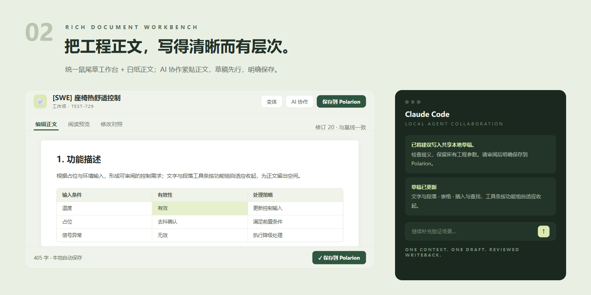](docs/assets/readme-workbench.png)

*按当前产品功能自绘，使用虚构示例；不是产品截图，不含真实项目、需求或对话信息。点击图片可放大。*

## 从需求全景开始

头部「总览」按钮在**左侧文档区**展开章节矩阵，不挤占 AI 侧栏。二级章是色带、三级分组是块、条目平铺：大分组按 18 项切块，无三级分组的整章多列铺开。

[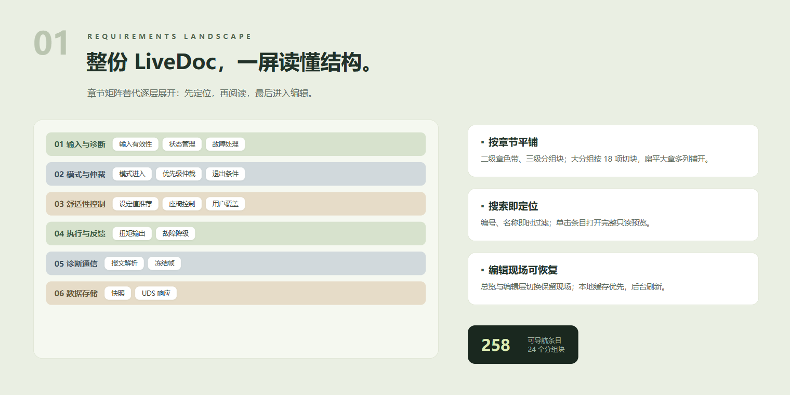](docs/assets/readme-landscape.png)

*自绘示意，使用虚构工作项；真实 SWR 文档实测 258 个条目、24 个分组块、零重叠。*

| 操作 | 行为 |
|---|---|
| 输入或 `Ctrl+F` | 搜索编号或名称，即时过滤 |
| 单击条目 | 打开完整**阅读预览**（只读） |
| 预览内「打开编辑工作台」 | 进入悬浮编辑器；编辑现场保留 |
| 编辑中再开总览 | 编辑层隐藏但保持挂载，关闭总览原样回来 |
| `Esc` | 关闭当前层，不误关其他弹层 |

本地缓存秒开、后台刷新；跨文档工作项会被拒绝。

## 变更管理：把一次修改变成可回看的记录

头部「变更」按钮打开独立工作台。修改前点「设定基准」，系统把此刻整篇文档写入当前 Polarion 项目；期间保存多少次都不打扰别人；改完点「结束并生成」，自动逐项对比并生成记录。忘了点基准，可从最近变更时间线里选「对比这次」，或任选前后基准补建。

[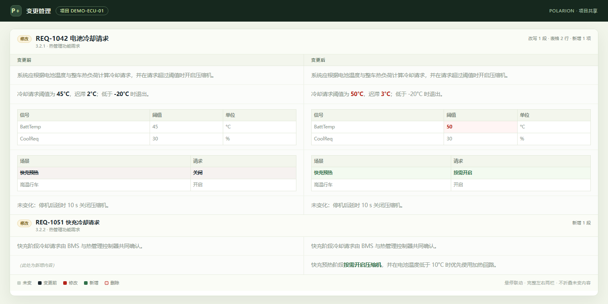](docs/assets/readme-change-diff.png)

*自绘示意，使用虚构项目与需求内容。*

每个变更工作项固定左右两栏：左栏完整变更前、右栏完整变更后；未变化的段落与表格也完整保留并灰显。变更前黑色加粗（纯删除加删除线）、变更后修改红色加粗、纯新增绿色加粗；悬停变更片段，两侧对应位置联动描边并浮出原文/新文。表格按行与单元格比对，未变行灰字白底，变化单元格与新增/删除行着色。

[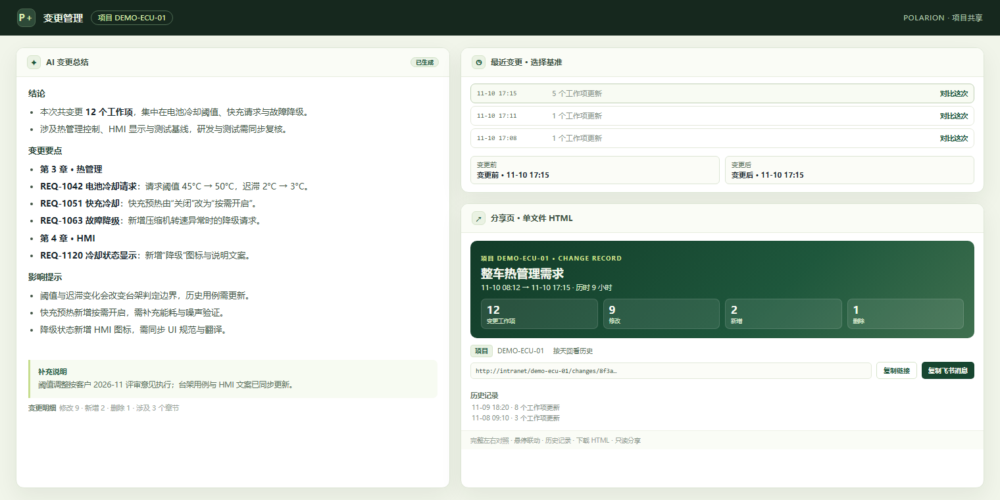](docs/assets/readme-change-share.png)

*自绘示意，使用虚构项目与需求内容。*

| 能力 | 行为 |
|---|---|
| 基准与结束 | 显式设定基准；结束才生成记录；可取消基准并清理快照 |
| 时间线补建 | 聚合工作项更新与历史 revision；选“最后一次/上上次/今天开始”即可，不手写时间 |
| 完整对照 | 左右两栏完整内容；未变灰显；块/词级 + 表格行/单元格级高亮；悬停联动 |
| AI 总结 | 结论 → 按章节的变更要点 → 影响提示；可重新生成，失败保留自动摘要 |
| 人工补充 | 补充“为什么改、影响谁”；与 AI 总结一起写入项目记录 |
| 记录存储 | 每次变更一个 Polarion 项目工作项 + 压缩附件；按项目隔离，项目成员共享 |
| 分享 | 内网分享页按天回看、完整对照、悬停联动；复制链接/飞书文案；下载单文件 HTML |

**记录不落在个人电脑上。** 基准快照、最终记录、AI 总结与补充说明都写入当前项目的 Polarion 工作项和附件；本机只缓存列表与正文，换电脑或换人后读取同一份项目记录。记录顶部与分享页顶部都会标注所属项目。

## @ 引用工作项，单击即读

编辑器正文和对话输入框都支持 `@`：列出**本文档全部工作项**，编号/标题即时过滤（中文紧邻 `@` 也触发）；候选按编号去重、最多 300 条；插入的是 Polarion 原生引用标记，保存往返不丢。编辑器、聊天与原生正文里的引用**单击**即打开完整阅读预览。

[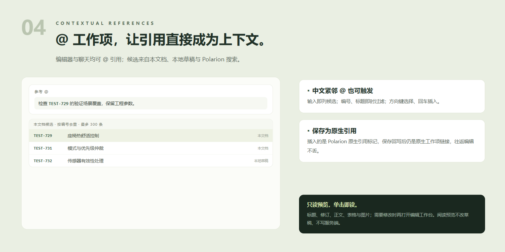](docs/assets/readme-references.png)

*自绘示意，候选来源：本文档 → 本地草稿 → Polarion 搜索。*

阅读预览是独立只读窗口，需要修改时再点「打开编辑工作台」。

## 同一需求，多个变体

主工作项保持文档槽位稳定；变体是 Polarion 项目里的**独立工作项**，通过可配置链接角色关联，需要时再接入主正文。

[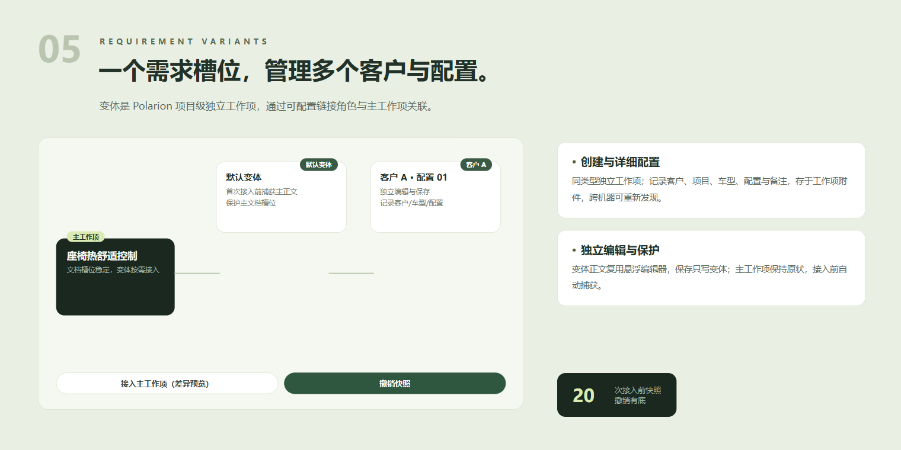](docs/assets/readme-variants.png)

*自绘示意，客户、项目与车型均为虚构。*

| 能力 | 行为 |
|---|---|
| 新建变体 | 同类型独立工作项，可复制主正文；详细配置存入工作项附件 |
| 默认变体 | 主工作项默认显示为「默认」；首次接入前先捕获成独立默认变体 |
| 编辑变体 | 复用悬浮编辑器；保存只写变体，不触碰主工作项 |
| 接入主工作项 | 差异预览、并发校验、画板快照复制、图片重新绑定、独立回读 |
| 撤销 | 保留最近 20 次接入前快照 |
| 跨机器 | 列表、配置与接入状态随 Polarion 链接与附件保存 |
| 解除 | 只删本地归属与链接，工作项本身保留 |

安全边界：只操作已登记并通过回读确认的变体；服务端写入仍走本地草稿 + 明确保存。

## 把空间留给正文与表格

「文字与段落」「表格」「插入与查找」各占一条功能行；空间不足时按名称收起功能组。编辑器提供标题段落、列表待办、提示块、代码块、链接、图片、查找替换与内容块移动复制；工程表格支持选区、行列增删移动、合并拆分与精确属性。受保护宏显示为紧凑 chip，保存原样写回。

[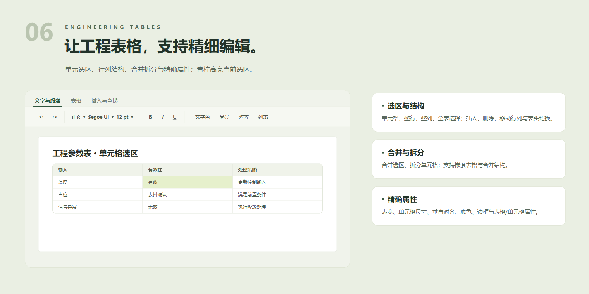](docs/assets/readme-toolbar.png)

*自绘示意；布局验收覆盖 1440–390px × 三组工具栏。*

## 从需求描述到可编辑配图

[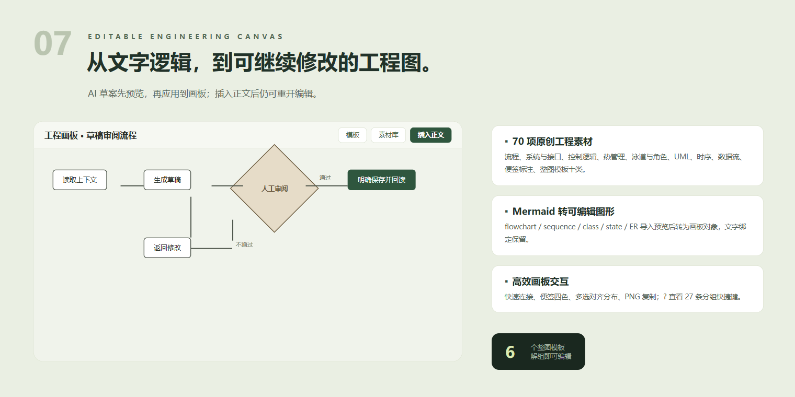](docs/assets/readme-board.png)

*自绘的虚构审阅流程，展示预览与可编辑图形能力。*

画板内置 **70 个原创工程素材**（流程、系统接口、控制逻辑、热管理、泳道、UML、时序、数据流、便签、整图模板十类）与 6 个整图模板。

| 能力 | 行为 |
|---|---|
| AI 整图 | flow / swimlane / sequence / class / er；草案先预览再应用，插入正文只改本地草稿 |
| 模板中心 | 6 个整图模板，缩略图预览后插入并选中 |
| Mermaid | 粘贴定义转可编辑图形，`Ctrl+V` 直接进入导入预览 |
| 快速连接 | 主菜单或 `C`，点起点→点目标自动连线 |
| 便签与对齐 | 一键便签、四色切换、多选对齐/分布 |
| 复制图片 | PNG 复制到系统剪贴板 |
| 快捷键 | `?` 打开 27 条分组快捷键帮助 |

生成器校验画幅、重叠、遮挡与连线穿越；放不下时返回布局提示，要求拆图而不是生成坏图。

## 保存机制

**本地自动保存保留草稿；“保存到 Polarion”才触发服务端写入。** Agent 权限模式不会取消明确保存这一步。

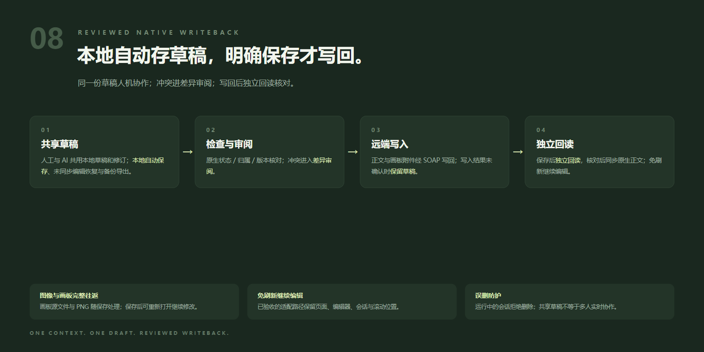

保存前检查原生编辑状态、归属与服务端版本；写入后独立回读核对，确认才更新原生正文。已验证的 21R2 路径保存全程免刷新。冲突进差异处理；写入结果不确定时保留草稿先核对服务端。

免刷新保存严格匹配已验证的 Polarion 21R2 构建；其他构建在远程保存前停止，需完成适配与验收。[保存与原生交替编辑验收](docs/整体精修与富文本验收_20261104.md) · [大型 LiveDoc 修复记录](docs/v0.2.6大文档保存修复.md)

## 会话效率与指令

[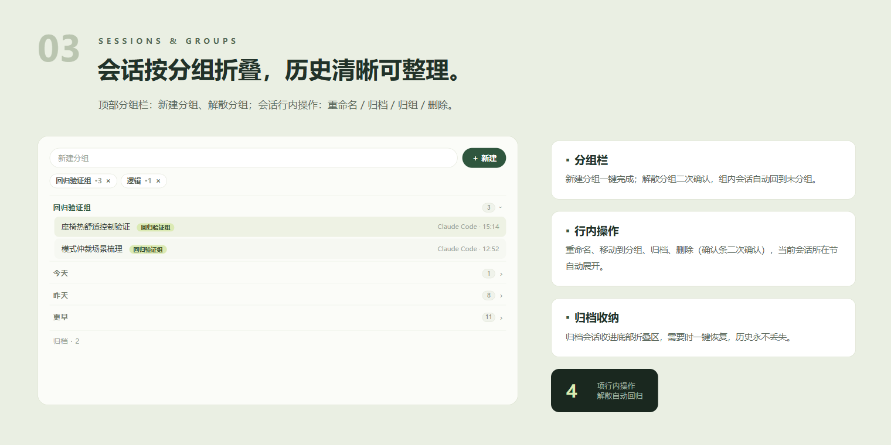](docs/assets/readme-sessions.png)

- **会话历史整理（0.6.0 新增）**：会话支持重命名、移动到分组、归档与删除（删除需二次确认；运行中的会话拒绝删除）。顶部分组栏新建/解散分组（二次确认，组内会话回到未分组）；列表按分组折叠展开，默认展开当前会话所在节。
- **批准方式**：默认“自动批准”；可切“请求批准”或“完全访问”，任务开始时固定本轮权限。
- **运行中继续输入**：默认“排队”（当前任务结束后自动发送，最多 5 条）；“引导”优雅打断并保留上下文。
- **预设指令**：分「随发送附加」与「通用指令库」；每条可挂多个本地文件，使用时重新读取。
- **消息操作**：复制回答、引用选中片段、同样请求重试；长会话挂载最近 40 轮。
- **设置持久化**：字号 9–18px、共享草稿文件夹、指令增删改、Polarion 账号连接。

[](docs/assets/readme-settings.png)

## 本机与服务端如何协作

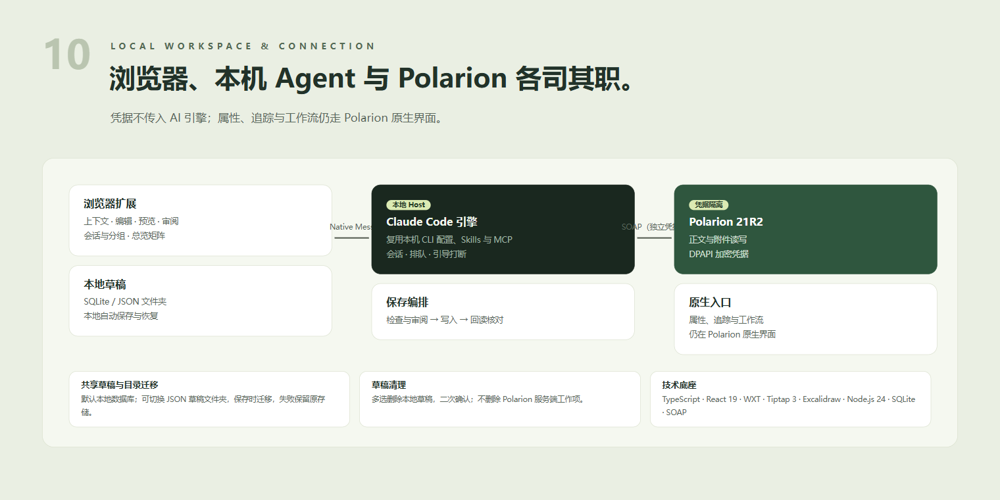

浏览器负责上下文、编辑与审阅；本地 Host 负责会话、草稿、Agent 运行和保存编排；Polarion 承载正文与附件。模型请求按本机 Claude Code 配置发送，不表示离线推理。

<details>
<summary><strong>技术栈、数据位置与目录</strong></summary>

| 部分 | 实现 |
|---|---|
| 浏览器扩展 | TypeScript · React 19 · WXT · Shadow DOM |
| 内容编辑 | Tiptap 3 · Excalidraw · 源 HTML 映射 |
| 本地 Host | Node.js 24.22.2 · SQLite · Native Messaging |
| 协议与状态 | Zod 校验 · 上下文快照 · 草稿修订 · 运行事件 |
| 变更管理 | 块级 LCS · 词级 diff · 表格行/单元格 diff · Polarion 项目记录 |
| Polarion 连接 | 独立凭据进程 · SOAP 读写 · 保存后独立回读 |

会话、草稿与项目目录默认位于 `%LOCALAPPDATA%\Nanju\PolarionSidebar`；凭据走 Windows DPAPI 加密，只进入独立 Polarion 进程，不传入 AI 引擎。共享草稿文件夹里的其他 JSON 不会被当作草稿。

```text
apps/extension/          侧栏、富文本、需求总览与画板
apps/host/               Agent、草稿、变体与保存服务
packages/core/           HTML、差异、画板、引用与格式逻辑
packages/protocol/       校验协议与共享类型
packages/polarion-soap/  SOAP 适配器与上游许可证
scripts/                构建、安装、版本与开发探针
docs/                   规格、验证报告与自绘功能示意图
```

</details>

## 安装与更新

当前交付方式是**源码开发安装**，请选择自己有写权限的固定本地目录；已验证路径包含中文和空格的安装。GitHub Release 自动提供的源码压缩包不是可直接加载的扩展包；图形安装器与自动更新尚未交付。UNC 网络目录、超长路径和只读安装目录尚未验收。

### 环境准备

| 条件 | 要求 |
|---|---|
| 系统与工具 | Windows x64、Git、现有 Node.js 20.11+（20.x）或 22+ 与 npm，仅用于引导；Windows PowerShell、.NET Framework 4 编译器。后续安装、检查及运行使用项目私有 Node 24.22.2，无需把全局 Node 固定为 24 |
| 浏览器 | 可加载本地 Chrome MV3 扩展；本轮实测使用 Ego，Chrome/Edge 的完整矩阵尚未验收 |
| Claude Code | 本机已安装并认证；自动发现 PATH、原生安装或 npm 安装，可显式指定 CLI 路径 |
| Polarion | 当前适配的公司 21R2 实例及自己的账号/访问令牌；可独立配置本工具凭据，不要求先安装某个 MCP |
| Skills 与 MCP | 使用自己的配置；Diagram Design 原文与许可证已随产品提供，其它外部能力按需配置 |

### 首次安装

获取有访问权限的私有仓库。以下命令针对 `v0.7.0` 源码。复现其它版本时，在安装依赖前切换到 [Releases](https://github.com/suzike-dev/polarion-super-sidebar/releases) 中对应的 tag，并遵循该 tag 自带的 README；旧版本可能尚无下列新脚本。

```powershell
git clone https://github.com/suzike-dev/polarion-super-sidebar.git
cd polarion-super-sidebar
git switch --detach v0.7.0
node scripts/setup-runtime.mjs
$node = '.\.runtime\node-v24.22.2-win-x64\node.exe'
$npmCli = Join-Path (Split-Path (Get-Command npm.cmd).Source) 'node_modules/npm/bin/npm-cli.js'
if (!(Test-Path -LiteralPath $npmCli)) { throw '请将 $npmCli 设置为已安装 npm 的实际 npm-cli.js 路径。' }
& $node $npmCli ci --ignore-scripts
& $node scripts/version.mjs check
powershell.exe -NoProfile -ExecutionPolicy Bypass -File scripts/check.ps1

# 账号密码在安装后的扩展设置中配置；终端方式为可选：
# powershell.exe -NoProfile -ExecutionPolicy Bypass -File scripts/configure-polarion-credentials.ps1
# 使用访问令牌时，在上条命令末尾增加 -AuthMode access_token。

./.runtime/node-v24.22.2-win-x64/node.exe scripts/diagnose-install.mjs --check-cli
powershell.exe -NoProfile -ExecutionPolicy Bypass -File scripts/install-dev-host.ps1
```

`setup-runtime.mjs` 下载并校验项目专用 Node 运行时，不修改全局 PATH；`check.ps1` 执行类型检查、330 项测试与构建；`install-dev-host.ps1` 为当前 Windows 用户注册 Native Messaging Host。首次安装尚未在设置中保存账号时，诊断可能报告凭据文件缺失；先完成安装，在设置中保存并连接后，再用 `--strict` 复查。

`$npmCli` 仅定位用户已安装的 npm，随后由项目私有 Node 执行；上面的定位适用于普通 Windows Node/npm 安装。如果工具管理器提供的是另一层 shim，请把变量设为该 npm 安装中的实际 `npm-cli.js`，无需修改系统 PATH。

上述 PowerShell 参数只应用于该次脚本进程，不修改用户或计算机的全局执行策略。诊断的 `--strict` 检查本机文件、构建产物、CLI 可执行性和凭据文件是否存在，**不证明 Claude 已登录、凭据能解密或 Polarion 账号权限可用**。可另做不联网解密检查：

```powershell
powershell.exe -NoProfile -ExecutionPolicy Bypass -File scripts/start-polarion-worker.ps1 -ValidateOnly
```

如果已安装的 CLI 未被发现，先用下文的 `-PrepareOnly -ClaudePath` 保存本工具路径，再重跑诊断并正式注册。使用自定义凭据文件时，直接运行 `-ValidateOnly` 也须加同一 `-CredentialPath`；这个检查脚本不会读取 launcher 配置。

凭据保存在当前用户的 `%LOCALAPPDATA%\Nanju\PolarionSidebar\credentials.json`，由 Windows CurrentUser DPAPI 加密。更换电脑或 Windows 账户应重新配置；无需复制开发者凭据、缓存或其它项目源码。已有兼容的 Polarion MCP 凭据可继续使用，配置本工具凭据不会覆盖它。替换本工具已有凭据需明确增加 `-Replace`，脚本会保留加密备份。

1. 在浏览器扩展管理页启用开发者模式，选择“加载已解压的扩展程序”。
2. 加载仓库中的 `apps/extension/.output/chrome-mv3` 目录。
3. 打开扩展页面 `chrome-extension://kmmphepmgnplcejfgiolhpfkgpcolcmp/diagnostics.html`，确认 Host 可连接，`extension` 与 `version` 一致（0.7.0）。
4. 打开已适配的 Polarion 文档，点击侧栏右上角设置，在“Polarion 账号”输入自己的用户名和密码，点击“保存并连接”。成功后即可打开编辑工作台，无需重启 Host。已用终端配置的账号可点“检查已保存的连接”。
5. 首次写回使用有授权的测试工作项，核对服务端回读与原生正文显示。

界面先验证 Polarion 登录，再原子替换本地加密凭据；登录或网络失败时保留原配置。密码以 Windows CurrentUser DPAPI 加密，不进入 AI 会话、普通设置数据库或命令行参数，提交后输入框清空。界面仅提供账号密码方式，访问令牌仍可用终端脚本配置。连接成功表示登录可用，不代表拥有所有项目的编辑权限。

### 更新已有开发安装

在保留本地改动的前提下更新源码，再执行以下检查与构建。使用发布 tag 安装的工作区，应先切换到目标发布 tag。

```powershell
node scripts/setup-runtime.mjs
$node = '.\.runtime\node-v24.22.2-win-x64\node.exe'
$npmCli = Join-Path (Split-Path (Get-Command npm.cmd).Source) 'node_modules/npm/bin/npm-cli.js'
if (!(Test-Path -LiteralPath $npmCli)) { throw '请将 $npmCli 设置为已安装 npm 的实际 npm-cli.js 路径。' }
& $node $npmCli ci --ignore-scripts
& $node scripts/version.mjs check
powershell.exe -NoProfile -ExecutionPolicy Bypass -File scripts/check.ps1
```

若浏览器仍加载早期的 `spikes/extension` 目录，构建后执行 `powershell.exe -NoProfile -ExecutionPolicy Bypass -File scripts/deploy-dev-extension.ps1`；直接加载 `.output/chrome-mv3` 的安装无需这一步。迁移安装目录时，先在旧目录撤销 Host 注册，再到新目录注册。

先在诊断页记下当前 Host 的 `pid`，等待 AI 任务结束，再关闭使用该扩展的浏览器以释放原生启动器，并在任务管理器中结束该 PID 对应的 Host。重新运行 `powershell.exe -NoProfile -ExecutionPolicy Bypass -File scripts/install-dev-host.ps1` 编译并更新启动器，再打开浏览器、重新加载扩展。下一次连接启动新版 Host；打开 Polarion 文档后在诊断页核对实际版本。**更新源码或 tag 不会自动替换正在运行的 Host 与扩展。**

<details>
<summary><strong>连接检查与卸载</strong></summary>

| 现象 | 检查位置 |
|---|---|
| Host 无法连接 | `diagnostics.html`；项目专用 Node、`dist/host` 构建与当前用户 Native Messaging 注册 |
| 扩展与 Host 版本不同 | 浏览器实际加载目录与运行中的 Host；完成重启和扩展重载后再核对 |
| Claude 无法启动 | `./.runtime/node-v24.22.2-win-x64/node.exe scripts/diagnose-install.mjs --check-cli --strict`；另检查 CLI 认证状态，特殊目录用安装器 `-ClaudePath` 指向实际 exe/js |
| 打开工作台提示 `POLARION_WORKER_STOPPED` 或凭据缺失 | 打开设置 → Polarion 账号，输入自己的账号密码，点击“保存并连接”。缺少凭据的提示提供“配置 Polarion 账号”入口。浏览器登录和 Codex 登录不会自动配置此凭据 |
| 检查凭据 | 运行 `powershell.exe -NoProfile -ExecutionPolicy Bypass -File scripts/start-polarion-worker.ps1 -ValidateOnly`；`configured` 和 `decryptable` 为 `true` 仅说明本机可解密，不验证账号或网络。自定义文件加 `-CredentialPath`，并确保与安装器配置一致 |
| 需求总览读取失败 | 先点总览右上角刷新；仍失败时确认账号可读取该文档，或换一篇文档排除单文档权限问题 |
| 原生保存适配不匹配 | 当前 Polarion 版本/构建；见[免刷新保存验收记录](docs/整体精修与富文本验收_20261104.md) |

Host 注册名为 `com.nanju.polarion.sidebar`。扩展身份来自 `apps/extension/identity.json` 的公钥，不应在更新时随意重新生成。

凭据文件已存在时配置脚本会拒绝覆盖。若确认需要替换本工具的凭据，可在配置命令末尾加 `-Replace`；原加密文件会备份。若安装时指定了自定义 `-CredentialPath`，请对该路径配置并检查，或重新安装以选择所需路径；默认路径的配置不会覆盖自定义路径。

安装器支持 `-DataDirectory`、`-ClaudePath`、`-CredentialPath`，只记录在本工具的 launcher 配置，不修改全局环境。需要仅编译而不注册时使用 `-PrepareOnly`。首次安装、迁移和隔离验证的完整命令见[跨电脑安装验收](docs/跨电脑安装验收_20261104.md)。

例如 CLI 与兼容 DPAPI 文件都位于自定义位置时，先准备配置，再检查，最后注册；请换成自己实际存在的绝对路径：

```powershell
powershell.exe -NoProfile -ExecutionPolicy Bypass -File scripts/install-dev-host.ps1 -PrepareOnly -ClaudePath 'D:\Tools\Claude Code\claude.exe' -CredentialPath 'D:\Private\polarion-credentials.json'
./.runtime/node-v24.22.2-win-x64/node.exe scripts/diagnose-install.mjs --check-cli --strict
powershell.exe -NoProfile -ExecutionPolicy Bypass -File scripts/start-polarion-worker.ps1 -CredentialPath 'D:\Private\polarion-credentials.json' -ValidateOnly
powershell.exe -NoProfile -ExecutionPolicy Bypass -File scripts/install-dev-host.ps1
```

同一安装重复运行时会保留已有 launcher 参数。自定义 `-DataDirectory` 后，默认命令不会自动把已有凭据迁过去；请在该目录配置 `credentials.json`，或同时指定 `-CredentialPath`。

卸载时，先在浏览器中移除扩展，再运行 `powershell.exe -NoProfile -ExecutionPolicy Bypass -File scripts/uninstall-dev-host.ps1` 撤销当前安装的 Host 注册。脚本保留本地草稿、会话、应用专用凭据和已有 Polarion MCP 凭据。

</details>

## 验收与边界

以下为有记录的实测范围，不代表所有规划功能均已完成。最新记录优先于历史报告中的旧布局、旧计数和旧缺口描述。README 中的配图均为功能示意；真实页面截图仅保留在本地验收材料中，不作为公开配图。

| 验证范围 | 已有结果 | 证据 |
|---|---|---|
| 自动检查 | 308/308 本机自动测试；Host/Extension 类型检查与构建通过；发布提交另经 Windows CI | 本轮自检（2026-11-06，发布前全功能回归） |
| 需求分析总览 | 真实 SWR 文档 258 项、24 个分组块、零重叠；长分组切块、扁平章多列、Ctrl+F、阅读预览→编辑工作台、编辑中隐藏/恢复通过 | [设计方案](docs/软件需求分析总览_设计方案_20261105.md) |
| @ 引用与阅读预览 | 中文紧邻 `@`、全量列表、弹窗内搜索、Esc/失焦/滚动关闭、插入原生引用、单击引用打开预览通过 | 本轮真实页面自检 |
| 变体管理 | 创建/链接、默认变体捕获、变体保存、接入/撤销、跨机发现、详细配置往返；并发刷新去重、默认捕获回滚、撤销入口修正由新增测试覆盖 | [变体管理](docs/变体管理_20261105.md) |
| 编辑器与保存 | TEST-728 真实编辑、保存、独立回读、原生正文同步；撤销修改后再次保存；受保护宏原样写回 | 本轮真实页面自检 |
| 设置与指令 | 字号 15/13 保存重开；临时指令创建、删除、保存重开确认消失；账号、存储和指令页签可用 | [设置与指令验收](docs/设置与指令验收_20261105.md) |
| 画板素材与模板 | 70 项素材十类加载、素材库打开；6 个整图模板预览与插入；吸附壳按真实边界；模板 ID/绑定重映射 | [画板对标与提升](docs/画板对标与提升_20261105.md) |
| Mermaid 与画板交互 | 真实页面粘贴导入、容器文字绑定、快速连接提示、`?` 单套帮助、复制图片到剪贴板通过 | 本轮真实页面自检 |
| Agent 对话 | 真实 Claude Code 回合“自检通过”完成；流式状态、回答操作、上下文与会话历史正常 | 本轮真实页面自检 |
| 单行布局与交互 | 5 个视口 × 3 组工具栏；具名容器、键盘、表格、查找、内容块等实测 | [同轮验收记录](docs/单行工具栏与原生排版验收_20261104.md) |
| 原生排版 | 新增正文、标题、整数 pt 字号及默认行高已核对；作者显式样式保留 | [排版结果与限制](docs/单行工具栏与原生排版验收_20261104.md) |
| 保存与连续编辑 | 隔离工作项真实保存、独立回读、原生显示；免重载、滚动保留、与原生交替保存通过 | [整体精修与保存验收](docs/整体精修与富文本验收_20261104.md) |
| Agent 与画板历史闭环 | Claude 修改草稿、人工确认写回；画板源文件与 PNG 回读及再编辑 | [S3 分阶段验证记录](docs/S3运行验证_20261103.md) |
| 跨目录首次安装 | 隔离 HOME/AppData、空缓存、C 盘中文空格目录，实际下载、构建、Native Messaging 启动与健康通信通过；未冒充第二台设备验收 | [安装证据与边界](docs/跨电脑安装验收_20261104.md) |
| Agent 复杂图 | 真实 Skill 调用、九节点分支回路、紧凑画幅、放大预览、人工修改、明确保存、源/PNG 独立回读与重开通过 | [图形验收](docs/Agent绘图与规范验收_20261104.md) |
| 回答密度与权限偏好 | 默认自动批准；字号 9–18px、取消回滚、保存重开和默认 13px 已在真实页面验证 | [Agent 与界面验收](docs/发布前Agent验收_20261104.md) |

**仍为 partial 或未验证：**

- **AI 整图生成：** `swimlane`、`sequence`、`class`、`er` 的 DSL、布局和校验由自动测试覆盖；长文本标签与动态行高已修复，但完整真实生成（含 6 类/6 实体密集关系）仍需逐类浏览器验收。
- **HTML 与 Office 兼容：** 任意旧 HTML、特殊宏、复杂 Office 粘贴和自定义段间距的像素一致性；服务端 HTML 保留不等于原生画面完全一致。
- **Codex：** 适配尚未接入，不属于本次可用能力；已有模型配置与会话保留。
- **外部 Agent 能力：** MCP URL 登录表单尚未接入；本机 Skills、MCP 和终端命令仅对逐项实际执行的路径给出通过结论，不能据目录发现推断全部可用。
- **完整能力对标：** 电子表格工作簿、公式、筛选、冻结行列、多视图、多人实时协作，以及完整飞书文档/画板功能。
- **环境与规模：** 其他 Polarion 构建、三浏览器完整矩阵、大文档和复杂画板的完整性能目标。
- **工程系统覆盖：** 完整文档编排、全部 V 模型操作、字段、追踪与工作流等规划能力。当前属性入口仍使用 Polarion 原生界面。

[CI](https://github.com/suzike-dev/polarion-super-sidebar/actions) 执行无业务凭据的检查、测试与构建。真实登录态、Agent 账号、服务端写回和原生交互需单独验证。

## 文档与维护

| 阅读目的 | 入口 |
|---|---|
| 看需求总览的设计与边界 | [软件需求分析总览](docs/软件需求分析总览_设计方案_20261105.md) |
| 看变体、设置与指令 | [变体管理](docs/变体管理_20261105.md) · [设置与指令验收](docs/设置与指令验收_20261105.md) |
| 看画板对标 | [画板对标与提升](docs/画板对标与提升_20261105.md) |
| 看本轮交互与原生差异 | [单行工具栏与原生排版](docs/单行工具栏与原生排版验收_20261104.md) · [整体精修与免刷新保存](docs/整体精修与富文本验收_20261104.md) |
| 追溯保存修复 | [原生 HTML 写回](docs/v0.2.5原生HTML写回修复.md) · [大型 LiveDoc 保存](docs/v0.2.6大文档保存修复.md) |
| 理解规划与实施 | [功能规格](docs/Polarion超级侧边栏_功能规格_v0.1.md) · [编辑工作台规格](docs/编辑工作台对标与交付规格_v0.3.md) · [开发进度](docs/开发进度.md) |
| 安装、复现与发布 | [变更记录](CHANGELOG.md) · [版本管理](docs/VERSIONING.md) · [GitHub Releases](https://github.com/suzike-dev/polarion-super-sidebar/releases) |

由 Nanju 维护。私有工程仓库，未授予项目整体的开源许可。第三方源码沿用各自许可证：SOAP 适配器见 [UPSTREAM](packages/polarion-soap/UPSTREAM.md)；Diagram Design 见[固定来源与原文校验](resources/diagram-design/README.md)和 [MIT 许可证](resources/diagram-design/LICENSE)。历史规格包含规划能力，实施状态以对应验收报告为准。
