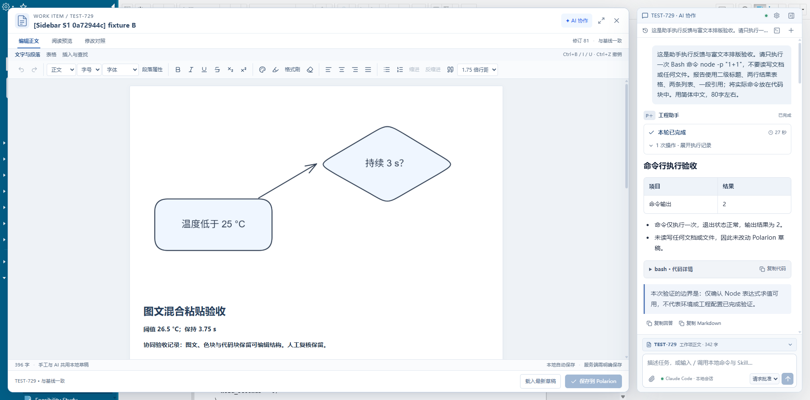
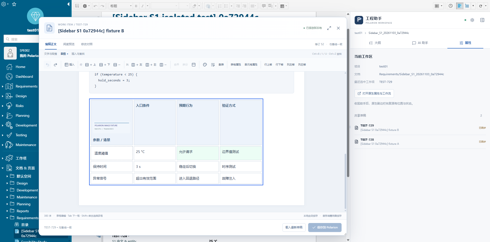
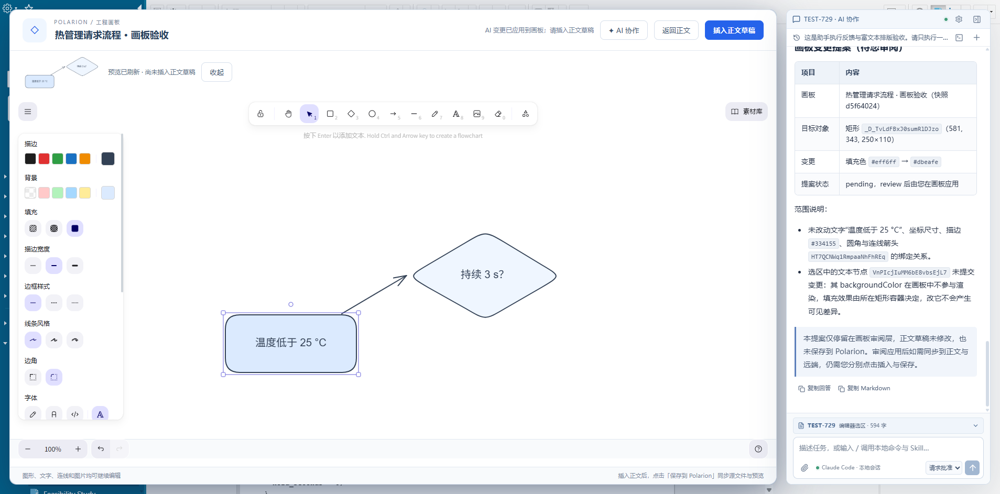
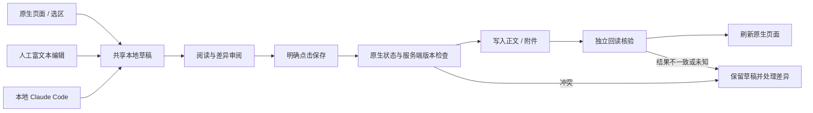
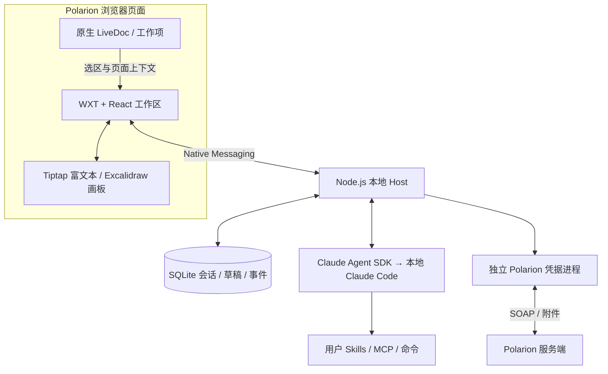

<div align="center">

# Polarion 超级侧边栏

**在真实工程需求旁，与本地 AI 一起阅读、编辑、审阅和保存。**

浏览器扩展 · 富文本工作台 · 本地 Claude Code · 可编辑工程画板


[](https://github.com/suzike-dev/polarion-super-sidebar/actions/workflows/ci.yml)

[快速开始](#快速开始) · [能力与边界](#能力与边界) · [架构](#架构) · [变更记录](CHANGELOG.md) · [版本管理](docs/VERSIONING.md)

</div>



*真实隔离测试截图：正文、画板预览与 AI 对话在同一个工程工作区中协作。示例参数仅用于功能验证。*

## 为什么做这个工具

工程需求编辑不只是在文本框里改几个字。它需要清晰的标题层级、可操作的表格、图片与流程图、上下文连续的 AI 对话，也需要把结果真正留在 Polarion 的工作项、附件和版本体系里。

这个项目在现有 Polarion 页面中加入统一侧栏与浮动编辑工作台，连接本机 Claude Code，让手工编辑和 AI 修改共用一份可审阅草稿。正文经明确保存写回原工作项；画板同时保存可编辑源文件与阅读预览。

**当前是 v0.2.5 开发基线，整体仍为 partial。** 本地 Claude Code 与已验证的工作项写回流程可运行；不能将本仓库表述为已完整覆盖飞书文档、表格、画板或 V 模型全部操作。

## 能力与边界

| 模块 | 当前能力 | 验证边界 |
|---|---|---|
| 统一工作区 | 大纲、AI、属性切换；展开/收起；浮动编辑器中的 AI 协作 | ego 真实页面已验证；Chrome/Edge 全矩阵待验收 |
| 上下文 | 正文、工作项与编辑器选区自动传递；可固定上下文 | 每轮冻结项目/文档目标，避免浏览切换改变正在执行的任务 |
| 富文本 | 标题、字体、颜色、高亮、列表、图片、粘贴、色块、代码块 | 复杂 HTML 与全部 Office 粘贴组合尚未全部覆盖 |
| 工程表格 | 插入、合并/拆分、行列调整、单元格样式和属性 | 当前是高阶文档表格；公式、数据类型及多视图尚未完成 |
| 本地 Agent | Claude Code 命令目录、Skills、MCP、附件、权限选择与持续会话 | 保留本地配置；部分终端专属交互有原生入口；并非所有命令均完成验收 |
| 工程画板 | Excalidraw 图形、文字、连线；选区进入 AI；提案、应用/拒绝 | AI 几何补丁仅支持受限对象，复杂折线、旋转、编组等明确拒绝 |
| 正文写回 | 共享草稿、差异审阅、冲突检查、明确保存、独立回读 | 正式需求与隔离样本已有实测；不能替代全格式兼容矩阵 |
| Codex | 保留 `gpt-6.1-sol` 配置及接入边界 | 当前登录拒绝该模型调用，完整产品适配尚未验收 |

## 工程表格与富文本



*开发过程中的隔离工程表格：图片与文字混排、行列操作、单元格配色及属性编辑。该截图展示功能形态，窗口布局以当前版本为准。*

正文采用保留源结构的 HTML 编辑方式。未知宏与暂不支持的结构保留原内容，避免在一次普通文字修改中悄悄丢失原始元素。图文保存增加原生容器，解决本环境中图片引用变化导致顶层标题与段落被转换的问题。

## 画板里的 AI 协作



*真实测试：选中节点 → AI 提出填充色变更 → 在画板中应用 → 更新阅读预览。正文保存另行明确执行。*

画板对象通过稳定 ID 与不可变快照关联。AI 先读取选中对象和相关连线，再生成受限变更提案。应用后的画板仍可手工编辑，源 JSON、PNG 和 manifest 一同存入 Polarion 附件；没有安装助手的用户也能阅读预览。

## 从修改到真正保存



本地草稿改变不代表服务端已保存。当前流程把正文、图片引用和样式值纳入回读核对；只接受属性顺序、实体编码及样式分隔空格等受限的序列化差异。未知结果先对账，不自动重复提交。目标 SOAP 服务未提供已验证的原子 CAS 保证。

## 架构



| 层 | 技术与职责 |
|---|---|
| 扩展 | TypeScript、React 19、WXT、Shadow DOM、原生页面适配 |
| 编辑 | Tiptap 3、Excalidraw、源 HTML 映射、阅读与差异展示 |
| 本地服务 | Node.js 24、SQLite、Native Messaging、持续 Agent 会话 |
| 协议 | Zod 校验、目标身份、上下文快照、草稿修订与事件 |
| Polarion 适配 | SOAP 正文/附件读写、来源归属校验、独立回读 |

Polarion 凭据来自本机已有 DPAPI 存储，只进入独立子进程。会话、草稿和项目工作目录保存在 `%LOCALAPPDATA%\Nanju\PolarionSidebar`。这些运行数据不属于 Git 基线。

## 快速开始

当前支持 **Windows 开发安装**。需要 Node.js **24.22.2** 与 npm、已安装并登录的本地 Claude Code，以及已有 Polarion MCP 凭据存储。此版本面向已适配的公司 Polarion 实例，尚不是任意域名即装即用产品。

```powershell
git clone https://github.com/suzike-dev/polarion-super-sidebar.git
cd polarion-super-sidebar

# 下载并核验项目独立 Node 运行时，不修改系统安装
node scripts/setup-runtime.mjs

# 锁定依赖；构建由后续检查脚本明确执行
npm ci --ignore-scripts
node scripts/version.mjs check
./scripts/check.ps1
```

检查通过后，注册当前用户的 Native Messaging Host：

```powershell
./scripts/install-dev-host.ps1
```

在浏览器扩展管理页启用开发者模式，加载 `apps/extension/.output/chrome-mv3`。当前本机开发环境已使用 `spikes/extension` 加载时，执行 `./scripts/deploy-dev-extension.ps1` 更新该目录，再重新加载扩展并刷新 Polarion 页面。

开发 Host 注册名为 `com.nanju.polarion.sidebar`，固定扩展 ID 为 `kmmphepmgnplcejfgiolhpfkgpcolcmp`。`identity.json` 中的是保持扩展身份所需的公钥，不是私钥。

卸载开发注册使用 `./scripts/uninstall-dev-host.ps1`；该脚本不删除草稿、会话或既有 Polarion MCP 凭据。正式安装包、自动更新及跨浏览器完整分发仍待完成。

## 验证基线

| 检查 | v0.2.5 的实际结果 |
|---|---|
| 自动测试 | 79 项通过 |
| 类型与构建 | Host / Extension 类型检查和两个构建通过 |
| 正式工作项 | 用户已审阅草稿写回、独立回读与原生页面检查通过 |
| 图文与画板 | 新源文件/PNG/manifest 单次保存，标题与背景保留，散列核验通过 |
| 持续会话 | 真实 SDK 冷/热两轮约16.7/3.9秒；UI 后续轮次约3.5秒 |

性能数据只是当次场景测量，不代表通用时延承诺。CI 只执行无业务凭据的类型检查、自动测试与构建，真实浏览器及服务端写回由隔离环境补充验证。

## 目录与文档

```text
apps/extension/      浏览器侧栏、富文本与画板
apps/host/           本地服务、Agent、草稿与保存服务
packages/core/       HTML 保真、差异、画板与格式逻辑
packages/protocol/   校验协议与共享类型
packages/polarion-soap/  Polarion SOAP 适配器及上游许可证
scripts/             构建、安装、版本检查与开发探针
docs/                规格、验证报告、版本约定与截图
.github/             CI 与 PR 模板
```

- [功能规格](docs/Polarion超级侧边栏_功能规格_v0.1.md) · [编辑工作台对标规格](docs/编辑工作台对标与交付规格_v0.3.md)
- [当前开发进度](docs/开发进度.md) · [v0.2.5 写回修复与验证](docs/v0.2.5原生HTML写回修复.md)
- [变更记录](CHANGELOG.md) · [版本与 tag 管理](docs/VERSIONING.md) · [v0.2.5 基线说明](docs/releases/v0.2.5.md)

本仓库为私有工程仓库，未授予项目整体的开源许可。引入的第三方源码沿用各自许可证；SOAP 适配器的来源与 MIT 许可证见 [UPSTREAM](packages/polarion-soap/UPSTREAM.md) 和相邻 LICENSE。历史规格包含规划能力，实施状态以当前开发进度及对应版本验证报告为准。
