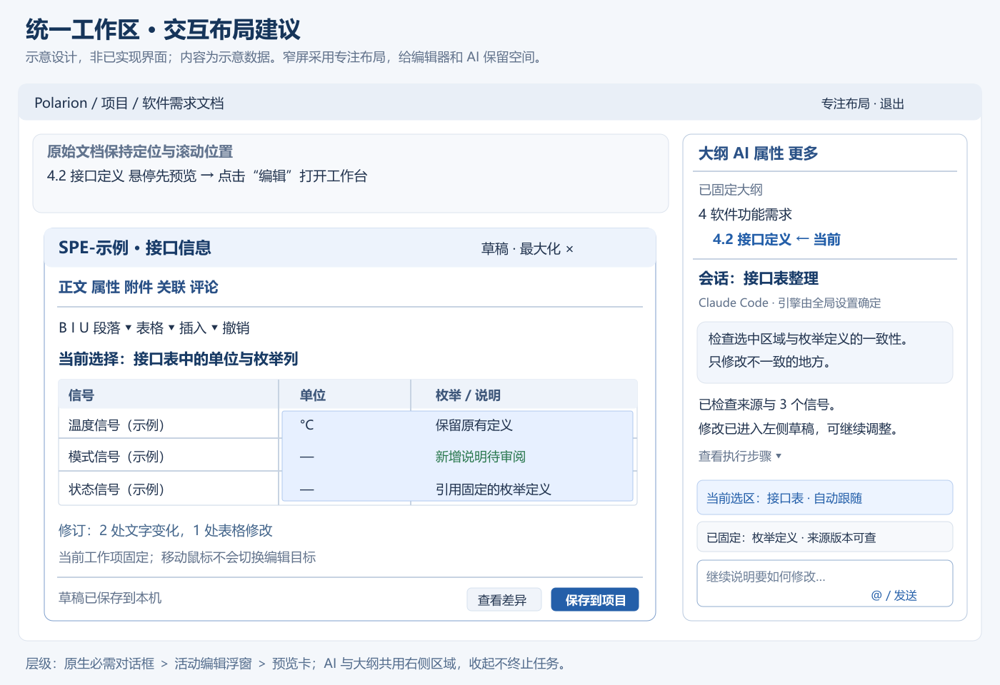
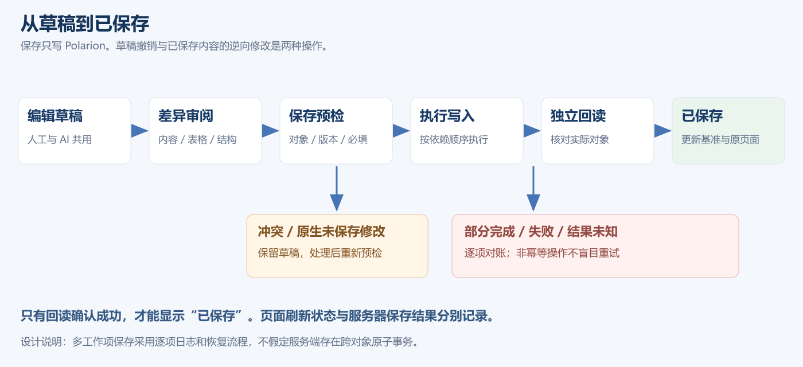
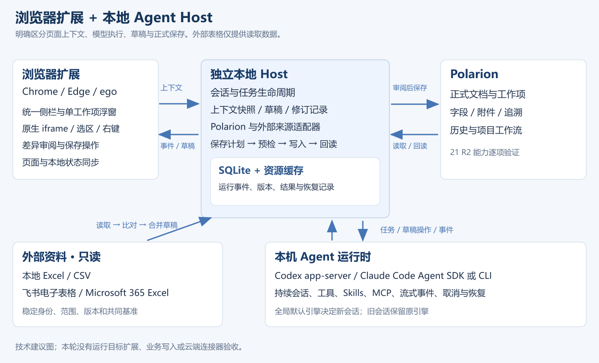

# Polarion 超级侧边栏助手

## 功能规格 v0.1 · 待审阅

日期：2026-11-02  
适用环境：Windows；Chrome / Microsoft Edge / ego；公司 Polarion 21 R2 实例  
首版定位：个人需求工程工作台；浏览器扩展＋轻量本地服务  
文档状态：17 题范围澄清已完成。本文定义待批准的功能与技术方案，尚未开发产品或验证生产写入。

本规格把在线文档、工作项、富文本编辑、AI 会话和已有追溯关系放在同一工作入口。用户可以选择原文，让本地 Codex 或 Claude Code 在共享草稿中修改；查看内容、表格和结构差异后保存到 Polarion，并看到服务端实际结果。

“已确认”表示用户明确选择的产品范围；“建议默认值”表示本版提出、待随规格一并审阅的设计；“未验证”表示还需运行试验的技术条件。本文所有性能数字是验收目标，不是现有实现的测试成绩。

### 阅读顺序

先阅读第 1—4 节的范围与交互，再阅读第 5—10 节的编辑、会话和保存规则；第 11—15 节说明技术方案、验证项、验收与交付。详细验收用例另附 CSV，可按需求 ID 回查。

## 1. 已确认的产品范围

| 决策 | 用户选择与最终含义 | 规格位置 |
|---|---|---|
| Q1 | 浏览器扩展＋轻量本地服务 | FR-01、11 |
| Q2 | 先服务用户个人，团队能力后续扩展 | 1、FR-23 |
| Q3 | 统一右侧工作区；大纲、AI、属性切换，可固定大纲同显 | FR-02 |
| Q4 | 悬停先出现轻量预览卡，点击编辑后打开浮窗 | FR-03 |
| Q5 | 完整的单工作项编辑工作台 | FR-04、FR-08—10、FR-13 |
| Q6 | AI 直接改助手草稿，查看差异后保存 | FR-07、FR-15 |
| Q7 | 首版聚焦需求文档、工作项、评审和追溯；模型、代码、测试深入操作后续扩展 | FR-19、FR-22 |
| Q8 | 同时支持在 Polarion 维护，以及以外部表格为维护入口 | FR-20—21 |
| 用户补充 | 原页面、右键入口和浮窗中的局部选区自动成为助手上下文 | FR-05 |
| Q9 | 当前选区自动跟随；重要片段可固定并跨工作项引用 | FR-06 |
| Q10 | 可识别的无冲突变化合入草稿，冲突由用户决定 | FR-21 |
| Q11 | 完整编辑当前文档，包括结构编排和批量修改 | FR-11—14 |
| Q12 | 按项目组织多个持久会话，可跨文档引用 | FR-17 |
| Q13 | 首版直接接入本地 Excel/CSV、飞书电子表格、Microsoft 365 在线 Excel | FR-20 |
| Q14 | 只写回 Polarion；所有外部表格只读 | FR-20—21、FR-15 |
| Q15 | 在助手中手动执行项目已有工作流动作，内容保存与流转分开 | FR-22 |
| Q16 | 全局选择默认引擎；新会话使用默认值，已有会话保留原引擎 | FR-18 |
| Q17 | Windows Chrome、Edge、ego 均为首发正式支持目标 | FR-01、FR-23 |

Q8 与 Q14 的组合含义：用户可以继续在外部表格工具中维护主表，助手读取变化、生成 Polarion 更新草稿；也可以直接在助手中维护 Polarion。首版不会反向修改 Excel、飞书或 Microsoft 365 表格。Q11 的跨工作项编辑与 Q12 的跨文档引用，不等于允许跨项目批量写入。

### 首版必须交付

统一侧栏、预览卡、单工作项浮窗、自动选区、固定引用、双引擎接入、持久会话、内容及结构草稿、差异审阅、当前文档批量编辑、三类外部表格只读连接、追溯关系维护、手动工作流动作，以及三浏览器的完整安装和运行验收。

### 后续范围

团队管理、企业统一分发、多租户；模型与代码的开发操作、测试运行和自动修复；跨文档或跨项目批量分发；向外部表格写回；双引擎自动协作。保留适配接口与真实上下游链接，首版不把这些能力列为完成条件。

## 2. 事实基础与需求动机

调研已在指定软件需求 LiveDoc 中完成大纲、属性、长表格、独立工作项编辑器、图片和需求—测试覆盖报表的实际浏览；没有修改或保存正式需求。该轮只覆盖代表性页面形态，没有对全项目内容做完整审核。证据见 [E1]、[E2]。

| 已观察事实 | 对产品的要求 |
|---|---|
| 右侧原生区域同时承担大纲、属性、评注、附件、审批等功能 | AI 必须共享并协调右侧空间，保留原生入口 |
| 1366×768 下两侧展开，文档 iframe 约 670 px；部分表格被裁切 | 窄屏布局、专注编辑、可缩放浮窗必须成为验收场景 |
| LiveDoc 位于同源 iframe；独立工作项另有富文本 iframe | 选区、右键、坐标和焦点要跨 frame 正确关联 |
| 工作项存在懒加载占位，标题也使用工作项宏 | DOM 只能提供当前上下文；完整内容和章节身份需业务适配层补全 |
| 原生富文本包含表格、图片、公式、交叉引用等 | 需保留 Polarion 内容语义，不能用普通 HTML 清洗结果覆盖原文 |
| 实际关系包含方向、跨项目目标及指定 revision | 追溯关系要保存角色、方向、项目和版本 |
| 文档图片来自 module-attachment，并带 revision | 工作项附件与文档附件必须分别管理 |

会议中提出了模块 I/O 表编辑繁琐、类型和枚举不一致、Excel/需求/模型多处维护容易漏改、跨模块职责难追踪等问题。会议纪要曾把外部表格方案表述得较确定，而文字记录保留了讨论过程；本规格以本次 Q8、Q13、Q14 的明确选择为准。[E3]

参考 Claudian 的原生 Agent 会话、上下文引用、Skills/MCP 与行内差异；参考 GenOffice 的选区编辑、可定位修改、修订审阅与任务进度。两者的交互思想用于本产品；Polarion 的对象身份、保存及工作流语义另外定义。[E4][E5]

## 3. 工作区与视觉交互

### FR-01 运行载体与入口

扩展只在用户配置的 Polarion 实例内激活。支持 LiveDoc 与独立工作项页面；其他报表页可显示关联信息和跳转入口，只有识别到明确编辑目标时才开放对应编辑动作。首版默认实例为用户指定域名，项目身份不写死在核心代码中。

入口包括扩展按钮、页面右侧收起入口、工作项预览卡、选区右键菜单和可配置快捷键。安装本地服务后提供引擎、Polarion、外部来源的连接诊断；连接失败时保留本地草稿和历史。

Chrome、Edge、ego 都是正式支持目标；“同为 Chromium”不能代替逐浏览器验收。ego 的扩展安装与本地连接是 G-01 验证项。

### FR-02 统一右侧工作区

建议顶部主标签为“大纲 / AI / 属性”，其余原生面板在“更多”中保持可达。打开 AI 时使用同一右侧停靠区域；切回原生面板保持原生对象、滚动和功能。扩展退出后恢复原先布局。

建议默认宽度 400 px，可在 340—560 px 间拖动，且不超过窗口宽度的 45%。大纲固定时，优先在同一侧栏上方显示可调整高度的大纲区域，AI 在下方，不增加第三条常驻竖栏。较低窗口将固定大纲压缩为目录路径和按需展开区域。

窄屏进入“专注编辑”布局时暂收起左侧项目导航，记录其原状态；提供显式的专注布局开关，用户手动展开后不立即反复收起。目标是正文可用宽度至少 720 px；空间不足时采用按需覆盖式面板或编辑区最大化，不把正文无限压窄。离开助手编辑后恢复用户选择的布局。

收起侧栏只改变可见性，运行任务继续。收起入口显示运行、待审阅、错误或未保存状态；展开后恢复当前会话和滚动位置。切换标签不销毁草稿，不重新启动 Agent。

### FR-03 悬停预览卡

建议鼠标停留约 400 ms 后显示预览卡；快速经过、滚动中、拖选文本和调整表格时不触发。卡片显示工作项 ID、标题、类型、状态、内容摘要、来源和“编辑 / 在助手中引用 / 打开原项”。未加载完整内容时显示加载状态，不能把占位文字作为需求摘要。

预览卡不抢输入焦点，鼠标可以沿连续路径移入卡片。离开两者后延迟约 200 ms 关闭，Escape 可关闭。点击编辑才创建或恢复编辑浮窗；键盘用户可通过工作项入口打开同样功能。

### FR-04 单工作项编辑浮窗

浮窗包括：身份与草稿状态栏、富文本工具栏、正文、按需展开的属性/附件/关联/评论区域、底部保存状态。支持拖动、缩放、最大化和回到原位置。默认只打开一个活动编辑浮窗；切换工作项时保留上一份草稿，避免叠起多个抢焦点窗口。

建议宽度 760—1100 px、高度不超过可用视口；在 1366 px 窗口中采用“左侧编辑工作区＋右侧 AI”的布局，允许最大化到正文区域。实际尺寸受可用空间约束，窄屏和高缩放时可低于建议宽度，表格使用横向滚动。不能遮住 AI 输入区、保存按钮或原生必须完成的对话框。

浮窗与 AI 可以交替获得焦点；浮窗不因鼠标移到另一个工作项而换对象。普通关闭保留草稿，明确的“放弃草稿”才丢弃修改；保存并关闭只在保存结果确认后结束编辑。保存失败保持浮窗与内容可恢复。

Ctrl+S 只在助手编辑器获得焦点时触发对应草稿保存；在原生编辑区域保持原生行为。Escape 关闭当前临时菜单或预览卡，再按明确的编辑器关闭规则处理，不丢弃草稿。

以下为交互布局示意，不是已实现界面或运行截图：

### 视觉与可用性建议

采用清晰的工程工作台风格：浅灰页面底色、白色内容面板、低对比边框、蓝色主操作；状态颜色同时搭配文字或图标。中文使用系统 UI 字体，正文建议 14—16 px，表格不靠缩小字号容纳更多内容。暗色主题只作用于助手区域，避免强行反转原生页面和图片。

工具栏按文字、段落、表格、插入分组；常用操作直接显示，低频项收进菜单。动画建议 120—180 ms，并遵循减少动态效果设置。所有核心操作支持键盘；焦点顺序、读屏名称、缩放后可达性纳入 NFR-03。

## 4. 选区与上下文

### FR-05 自动捕获局部选区

原生 LiveDoc、独立工作项编辑页、助手浮窗内的非空选区，自动显示为当前会话输入区上方的临时上下文卡片。支持文字、段落、表格单元格/区域；图片或嵌入对象使用显式对象选择。右键打开菜单前保存选区快照，菜单获得焦点后仍能正确引用原选区。

自动捕获只是准备上下文，不自动发送模型请求、不提交修改。选择助手输入框或对话文字不能反过来替换需求选区。iframe、Shadow DOM 与文档滚动坐标需要统一处理。

右键建议提供“解释 / 改写 / 补全 / 检查一致性 / 固定为上下文”；这些命令使用相同的上下文模型。读操作可直接得到回答，写操作生成草稿差异。不得只传 selectedText 而丢失所属工作项、位置和版本。

### FR-06 跟随、固定与稳定定位

新选区替换临时选区；固定片段持续保留，可以跨工作项和文档引用。卡片显示项目、文档、工作项 ID、摘要、来源版本和“原文 / 草稿”标记，并支持定位、展开、移除。超出模型上下文容量时明确显示摘要、排除或待加载部分，不静默截断。

发送消息时形成不可变的上下文快照与目标范围。此后新选区只影响下一条消息。跨项目固定片段可作为资料引用，不自动成为写入目标。

建议锚点至少包含实例、项目、文档、工作项、字段、块/表格标识、选区内容摘要及源版本。表格优先使用业务行键与列映射，段落使用稳定节点标识与附近文本辅助定位。相同文本重复出现、行重排或原文已变更时，必须重新定位或提示冲突，不能按首次字符串匹配盲目替换。

固定片段保留发送时的快照；发现当前来源变化时提示“来源已更新”，允许刷新并查看变化。历史消息保持其当时引用，不能悄悄改写历史证据。

## 5. 草稿与富文本编辑

### FR-07 人工与 AI 共用草稿

每个工作项/文档维护服务端基准、当前草稿、修订操作和来源映射。人工输入与 AI 工具都作用于同一草稿模型。AI 一次修改可以作为一个可撤销组，同时保留细粒度文本、单元格、字段和结构差异。

差异至少区分新增、修改、移除和结构移动；提供行内显示与并排对照。允许继续手改、让 AI 二次调整、撤销一组修改，或选择部分变化保存。不得把 AI 回复中的自然语言“已完成”当作已经保存。

AI 生成期间用户仍可编辑。补丁必须绑定生成时的草稿版本；当用户已改动相同内容时，进入待合并状态。不同段落可在验证后合并，同一字段或单元格不自动覆盖最新人工输入。

建议草稿在本地短延迟自动持久化，界面显示“草稿已保存到本机”与“已保存到 Polarion”两个不同状态。草稿恢复不意味着业务服务器已更新。

### FR-08 富文本能力与往返保真

支持段落、标题层级、字体与字号、粗体/斜体/下划线/删除线、上下标、颜色、列表与缩进、对齐、链接、交叉引用、图片、表格和公式。标题和工作项边界需要识别 Polarion 语义，不能任意改成普通样式文本。

| 内容 | 编辑/展示要求 | 保存要求 |
|---|---|---|
| 常规文本、列表、上下标 | 原生富文本操作；中文输入法和撤销完整 | 保留字符、段落及有效样式语义 |
| 表格、合并单元格、嵌套内容 | 结构化编辑、表格差异 | 保留行列及合并关系，不能扁平化 |
| 图片与附件引用 | 缩略图、原尺寸预览、替换与新增 | 保留所属对象、附件身份及 revision |
| Polarion 宏、交叉引用 | 专用节点或受保护对象 | 保留原始语义和对象身份 |
| 公式与原生插图 | 可识别类型使用对应编辑；其他类型保真展示 | 不把公式降成普通字符或遗失原始数据 |
| 未识别嵌入内容 | 受保护块，说明可编辑边界，周边内容仍可编辑 | 未修改内容使用原始片段；不能清洗后无声丢弃 |

“受保护块”是保真降级方式，不等于已经完成该类型的增强编辑能力。验收必须分别记录可编辑、可保真保留和不支持的类型。空操作往返不得造成实质内容变化。

剪贴板支持纯文本、HTML 表格及 Excel 多单元格粘贴；可选择保留格式或仅内容。显示层去除可执行脚本和危险事件属性，保存层保留经过分类的工程语义，不能把安全展示处理等同于任意改写原始 HTML。

### FR-09 工程表格

支持插入/删除/移动行列、合并与拆分、列宽、表头、单元格对齐、批量粘贴、查找替换、矩形区域选择、撤销重做。大型表格提供专注视图，表头固定和横向滚动不影响底层行顺序；筛选/排序预览不自动重排正式需求。

AI 修改按表格、业务行键、列和版本定位。单位、范围、初值、枚举、内部/外部信号映射可以作为项目配置的列角色。信号重命名、重复行键、公式与显示值、隐藏行列及合并单元格均须明确处理，不能凭行号推测对应关系。

提供项目可配置的 I/O 表模板，以及“检查缺失单位、枚举不一致、输出没有对应逻辑说明”等辅助检查。AI 的解释性检查与确定性数据校验分别标识，结果附来源和定位。

### FR-10 图片、附件与评论

附件列表显示名称、所属对象、类型、大小、可获取状态及版本信息。支持在草稿插入本地图片、查看/下载已允许读取的附件、按需提取附件内容作为上下文。提取失败或未读完必须显示状态，不能把附件名称当成附件内容已读。

新增图片先成为本地草稿资源，正式保存时再通过对应适配器上传并替换为真实引用。工作项附件和文档附件不可混用。附件上传成功但正文保存失败时记录资源状态，重试复用已确认资源；不自动删除不确定是否被其他内容引用的附件。

评论区显示 Polarion 实际讨论串。用户可撰写评论或让 AI 生成评论草稿，点击发布后写入原工作项并回读。聊天消息、AI 预审问题和正式评论不是同一数据对象，不自动互相发布。

## 6. 完整文档与追溯

### FR-11 完整文档读取

文档模型包含章节树、文档顺序、工作项引用、段间正文、图表、附件引用及字段。工作项内容、文档编排和段间正文分别加载，不以页面已经渲染的节点数当作全量读取结果。

可按选区、工作项、章节或全文选择处理范围。全文任务先建立清单，显示已读/总数与未解析项；缺失内容影响任务时明确停止对应结论。跨文档引用采用明确来源和版本，不在后台默认扫描所有项目。

### FR-12 章节与工作项编排

支持章节新增、重命名、层级调整、移动和移除；新增工作项、文档内移动、拆分合并与移出文档。执行前在草稿中展示结构前后对照及受影响对象列表。

拆分建议保留一个原 ID，并为新增需求创建新 ID；合并需要明确保留的目标 ID。来源工作项、入向关系和历史必须在预览中列出；移出文档与永久删除是不同动作。默认合并不永久删除来源工作项，也不代替用户自动改变其工作流状态。

新建对象在草稿使用临时 ID，保存后绑定服务端真实 ID，再建立依赖关系。章节重排要同时核对顺序、父子关系和段间正文位置。文档引用项与本地拥有项分别识别；引用其他文档的工作项时说明实际内容所有者，不能因它在当前文档可见就假定可在当前范围覆盖。

此项是首版完整性要求，也是 G-02 技术验证重点。若目标实例缺少某种结构接口，应提出具体适配或范围修订，不能把仅更新正文的功能标为“完整文档编辑已完成”。

### FR-13 关联、来源与复用身份

关联面板展示上游需求、下游实现/测试引用及复用关系。保存关系角色、方向、来源项目、目标项目、目标 ID、目标 revision；“has parent”“duplicates”“is duplicated by”等语义不得合并成无方向链接。

支持查询目标、添加/移除关系并预览受影响的关联。跨项目目标可以引用，但本次操作仅修改已授权范围内的关系对象。读取目标失败时保留未知/不可读状态，不视为目标不存在。

查看测试覆盖时保留查询条件、目标版本和资料时间。未找到关联用例、未执行、失败和通过必须区别展示；AI 建议不构成正式评审通过或测试验证证据。模型和测试入口在首版提供链接及上下文，深度执行放在后续。

### FR-14 文档内批量操作

批量目标由选中的工作项、章节或明确查询确定，预览中展开为固定对象清单。支持统一字段、格式、术语、表格结构以及需求内容改写。用户可排除某项，保存前重新核对清单及版本。

字段类型和枚举使用项目元数据；不把一个项目的字段值硬套到其他对象。类型不匹配、必填缺失、引用项不可编辑或内容未完整读取时，对受影响项标明原因，不能静默跳过后报告全批成功。

批量保存采用操作计划与逐项结果，不宣称服务端提供跨对象事务。批次中断、部分成功和未知结果按 FR-15 恢复。

## 7. 保存、冲突与恢复

### FR-15 保存状态与服务端结果

保存流程：冻结待保存草稿和目标清单 → 校验字段与引用 → 重新读取目标版本 → 合并/解决冲突 → 按依赖顺序执行 → 独立回读 → 对比 → 刷新原页面。用户看到的状态至少区分“有修改、校验中、保存中、已保存、冲突、部分完成、结果未知、失败”。

只有服务器回读确认目标字段、内容、结构或关系后，才显示该对象已保存。页面 DOM 的临时更新、API 超时或 AI 回复不能替代回读。保存成功后更新基准版本，原页面保持定位、滚动和大纲展开状态；若页面缓存尚未刷新，单独显示刷新状态。

如果原生 Polarion 编辑器已经有未保存内容，助手可以读取选区和继续生成独立草稿，但不得盲目写回或刷新该页面。先让用户保存原生修改并重新对齐，或在验证过的完整导入路径中把原生修改纳入草稿。无法完整识别原生未保存状态时，写回前提示具体未解决状态。

同一文档在多个浏览器标签打开时，本地 Host 协调本产品的写入所有者和草稿版本；这不构成服务端对其他用户的锁。保存前的 expected_updated 或散列比对是漂移检测，不是原子 CAS。目标服务缺少条件写时保留竞态说明，按对象串行写并回读，不能承诺绝对不会并发覆盖。[E6]

网络中断后，已确认保存、明确失败和未知结果分别记录。对创建项、评论发布、附件上传等非幂等动作，先查明上次结果再重试；无法确认时不自动重复创建。不能通过无条件“回滚整批”覆盖其他人的后续修改。

### FR-16 撤销与本地恢复

未保存修改可通过编辑器撤销、撤销一组 AI 修改或恢复本地检查点处理。已经保存到 Polarion 的修改若需撤回，应读取当前服务端状态，生成逆向修改草稿，再审阅保存；界面明确区别草稿撤销和已发布修改的恢复。

本地保存会话、上下文清单、草稿版本和操作日志。浏览器崩溃、扩展重载、Host 重启后恢复可确认的状态；未确认完成的远端操作进入对账流程。恢复后的旧上下文要标记来源版本，不自动冒充当前状态。

建议提供草稿管理页、项目级备份/导出和用户可配置的清理策略。操作日志记录对象、版本、动作与结果，不记录凭据或完整认证报文。

## 8. 本地 Agent 与会话

### FR-17 项目内持久会话

按实例＋项目组织多个会话，支持新建、命名、搜索、归档和恢复。项目内切文档不强制换会话；当前页面上下文与固定资料卡清晰区分。跨项目切换时显示项目变化，并切换到目标项目的会话列表，不能静默把新项目资料注入旧项目运行任务。

会话保存引擎身份、原生会话 ID、任务日志和引用；历史消息不等于每轮都全文送入模型。上下文压缩后保留关键决定、目标、未完成项和来源指针，并能显示已使用范围。

同一原生会话中的任务按运行时能力串行或排队；用户追加说明使用明确的“补充当前任务”动作。并行会话可以运行，但对同一草稿的修改需版本协调。新任务不因旧会话被隐藏而丢失。

### FR-18 Codex / Claude Code 原生能力

全局设置选择默认引擎及可用模型，新会话使用该值；已有会话保留其创建时的引擎，运行中的任务不随默认值变化。对话界面显示当前引擎身份，但不提供逐会话切换入口。

必须支持持续多轮、流式回复、工具调用进度、用户输入请求、取消和恢复；支持发现并使用所选引擎的 Skills、MCP 和项目指令。提供 @ 引用、/ 技能/快捷任务入口、文件与图片上下文，以及可折叠的执行步骤。

“搬入本地能力”按能力清单验收，不承诺复刻终端的全部 UI。原生配置以只读发现为起点，显示实际生效的来源；本产品适配参数放在自己的项目/运行配置中，不重写用户全局配置。既有登录方式的复用需逐引擎验证，不能假设 SDK 自动加载所有 CLI 配置。

Agent 可以读取任务范围内资料、检索来源、调用需求分析工具并修改本地草稿。Polarion 正式写入由保存服务执行，Agent 提供的补丁不能绕过草稿审阅；导入已有 MCP/Skills 时仍须遵守该行为约束。外部表格适配只暴露读取能力。

收起侧栏、切换文档和短时通信断开不得终止健康任务。Host 保存进度并支持重新订阅。用户明确取消才发送取消指令；模型等待、工具执行、网络等待分别显示。连续运行超过 5 分钟不应因旧代码固定超时而被误杀；异常检测依据心跳、可恢复错误与运行时事件。

### FR-19 需求工程助手能力

首版预置任务：解释选区、按关联来源补全条件、检查歧义/可验证性、检查单位和枚举、比较上下游需求、检查 I/O 与逻辑覆盖、整理评审问题、按模板编写或重组当前文档。规则允许按项目补充，并显示引用来源。

结果区分“发现的事实、AI 推断、建议修改、待确认问题”。缺失阈值、计时或枚举时提出待确认项，不凭空补成项目结论。平台资料与项目需求冲突时展示来源及适用范围。

默认根据当前选区与所属工作项按需补充上下文，允许加入章节、文档或关系对象；加载前后显示范围。图片、PDF 和 Word 附件的解析作为资料读取能力，保留页码/位置和解析状态；首版不包含直接编辑外部 Word/PDF 文档。

需求预审结果可以转成修改草稿或评论草稿，但不自动发布评论或改变工作流。代码、模型和测试资料可以作为明确选择的上下文，首版不发起模型开发或测试执行工作流。

## 9. 外部表格与差异合并

### FR-20 三类只读来源

| 来源 | 首版直接接入方式 | 数据与边界 |
|---|---|---|
| 本地 Excel / CSV | 文件选择或项目绑定路径；本地解析 | 选择工作表/范围/列；保留编码、单元格类型、公式与缓存值说明 |
| 飞书电子表格 | 通过在线连接读取指定表格与范围；已有 lark-cli 可作为本机适配选项 | 记录实际 Sheets 对象及范围；wiki 链接先解析对象类型；飞书多维表格不是同一接口，未包含在本次电子表格目标中 |
| Microsoft 365 在线 Excel | 连接指定 driveItem，通过 Graph 在线获取工作簿并本地解析，或经验证的只读范围接口 | 记录租户/驱动器/项目身份与版本；不要求用户每次手动导出；不为读取默认引入写入操作 |

三类来源均只读。只读浏览、API 读取和生成助手内部缓存不视为修改源表。连接器实现不得带入修改/追加/删除源表的工具。公式计算以来源保存结果为准，无法得到最新计算值时显示缺口，不能把缓存值冒充实时重算。

账户连接、文件定位和数据读取分别诊断。认证成功但指定对象不可读、部分范围读取失败、权限过期、限流或离线时，显示具体状态和重试入口；已缓存内容显示抓取时间和版本。

### FR-21 绑定、共同基准与合并

绑定记录来源标识、工作表/范围、业务行键、列映射、目标文档/工作项/表格身份、基准快照与版本。初次绑定先预览匹配结果；同名表格、重复信号名和空行键不能自动判定为同一对象。

默认在用户打开绑定资料、发起比对或明确刷新时读取当前来源，不启动全盘或全租户扫描。后续后台刷新属于可配置增强项，不影响首版核心闭环。

合并比较上次明确对齐的基准、当前 Polarion 内容和当前外部内容：仅一边变化采用该变化；两边相同变化合并一次；可确认独立的变化合入草稿；同一内容不同变化进入冲突。删除、改名、行重排、单位变化和引用变化作为显式操作展示。没有可信基准时做两方比对并由用户选择。

保存目标只有 Polarion。外部内容不会因合并更新，因此每次保存后分别记录两端快照、用户处理结果和仍存在的差异，不能错误标记“两端已同步”。用户明确选择保留 Polarion 某项差异时保存该解决记录，避免下一次无变化比对重复要求处理；来源再次变化时重新判断。

AI 可以解释冲突和提出合并建议，不能替用户选择相互矛盾的工程值。所有合并结果继续遵循 FR-07 与 FR-15。

## 10. 工作流、设置与运维

### FR-22 原有评审与状态流转

在浮窗/属性区读取当前项目、当前账号对目标工作项实际可用的流程动作。用户手动执行，提交前显示目标对象、动作和必填内容；服务端返回后独立回读状态。AI 内容预审、普通保存和工作流动作在界面上分开。

动作条件不满足、状态已被其他人改变或权限变化时，刷新可用动作并保留草稿，不通过直接写 status 字段绕过工作流。需要原生签名或特殊原生对话框的动作，在未完成适配前明确转到原生入口，并回读结果；不能宣称签名适配已完成。

首版以单工作项手动动作保证闭环；多项动作可使用显式清单逐项执行，但不得因用户只保存正文而自动推进整批流程。

### FR-23 安装、更新与故障恢复

交付 Windows 本地 Host 安装包、三浏览器扩展安装材料、连接诊断、更新和卸载说明。首版个人使用允许开发者模式安装扩展，但必须保持稳定扩展身份；不能把一次性浏览器脚本作为最终交付。

按当前用户注册本地连接，不要求用户每次打开命令行启动服务。更新前保存本地状态，更新后检查 Host/扩展协议兼容。卸载分别处理程序和用户数据，数据清理由用户明确选择；不修改公司 Polarion 服务端配置。

连接诊断显示实例、项目可读性、工作项可读性、必要附件能力、引擎版本、外部表格状态与当前浏览器能力。故障报告可导出脱敏事件、版本和目标对象标识；认证数据不进入报告。

### FR-24 项目设置与默认值

全局设置包含默认引擎、主题、字体和快捷键。项目设置包含工作区目录、Polarion 实例/项目、模板、术语/表格规则及外部来源绑定。配置变更有可查看的差异，不重写引擎或 MCP 的全局配置。

默认参数为本版建议，可随交互验证调整：预览停留 400 ms、侧栏 400 px、单活动编辑浮窗、本地草稿自动保存、外部来源按需刷新。产品界面优先使用“来源、草稿、差异、保存、恢复”等用户术语，协议名和内部工具参数放入诊断视图。

## 11. 推荐技术方案

### 11.1 架构

浏览器扩展负责页面上下文与交互；独立本地 Host 负责 Agent 生命周期、草稿、连接器与保存服务；Polarion 保留正式对象、历史和工作流。Host 不因侧栏收起而退出。AI 输出通过结构化草稿操作落地，正式写回使用独立提交通道。

| 层 | 推荐技术 | 选择理由与边界 |
|---|---|---|
| 扩展构建 | WXT、TypeScript、Manifest V3 | 多浏览器构建与清晰入口；ego 必须单独验证 [T1] |
| 界面 | React 19、Radix UI、CSS variables / Tailwind、Zustand、TanStack Query | 统一交互状态与远端数据状态；Shadow DOM 隔离样式 |
| 富文本 | Tiptap 3 / ProseMirror、自定义 Polarion 节点与序列化适配 | 可扩展语义模型；保真能力由样本验证，不能由编辑器品牌保证 [T2] |
| 大表格与历史列表 | TanStack Virtual，批量差异计算放 Worker | 限制长列表渲染，避免每个 token 触发整篇文档更新 |
| 本地 Host | TypeScript、受支持的 Node.js LTS、SQLite、文件资源缓存 | 共用类型定义、持续进程、可恢复会话与操作日志；具体版本在开发锁文件冻结 |
| Chrome / Edge 通信 | Native Messaging 小型宿主＋独立 Host；本机 IPC | 浏览器官方支持的本机连接；宿主退出不应带走所有任务 [T3][T4] |
| ego 通信 | 优先相同通道；如不支持，验证受限 loopback 配对通道 | 两条路线均需实际验证；不预判已有完整支持 |
| Codex | 本机 app-server 协议适配 | 持续会话、事件、工具与恢复；以安装版本生成的协议为准 [T5] |
| Claude Code | Agent SDK 适配本机运行时；必要时使用经验证的 CLI stream-json 适配 | 保留原生 Agent 能力及会话，不固定旧 plan/临时模式 [T6] |
| Polarion | 独立适配接口，优先复用本地 MCP 的 SOAP 21 R2 经验 | 工作项、字段、附件、关系、流程分别探测；完整文档编排另做能力验证 [E6] |
| 外部资料 | 本地 XLSX/CSV 解析器、飞书只读连接器、Microsoft Graph 只读连接器 | 保持来源身份、版本和范围；不向源表写入 [T7][T8] |
| 验证 | Vitest / 属性测试、浏览器端到端测试、真实 Polarion 隔离文档验收 | 单测覆盖合并与序列化；实际保存必须有运行回读证据 |

首版主载体采用用户确认的浏览器扩展。旧 SideAgent 可复用经过验证的适配片段，但不直接复制其临时会话、页面隐藏即取消、固定超时和旧写入策略。新实现建立清晰模块边界；旧 MCP 不做全局原地改造。[E7]

### 11.2 原生页面适配

用业务身份识别对象：实例＋项目＋文档位置＋工作项 ID＋版本。DOM_数字 ID 和可见文本不是稳定主键。内容脚本分别处理顶层页面及相关 iframe，并将 frame 内选区转换为统一坐标与业务上下文。

原生 GWT 管理的节点避免任意搬入 React 或 Shadow DOM。建议以布局适配器在原生侧栏区域叠放/切换扩展面板，固定大纲时保留原生节点及事件生命周期。路由变化、iframe 重建和原生面板变化后重新绑定，退出时恢复修改过的样式与监听器。

采用局部观察和事件委托，不对整篇 LiveDoc 的每次变化做全量 DOM 遍历。原生 modal、浮窗、预览卡、提示层按照明确层级协调，不设置无限大的 z-index 压住所有原生操作。

### 11.3 数据对象与接口契约

| 对象 | 最少身份/状态 | 用途 |
|---|---|---|
| DocumentRef / WorkItemRef | 实例、项目、文档位置、工作项 ID、revision/updated | 唯一业务定位 |
| ContextSnapshot | 来源身份、源版本、字段/块/选区、摘要与完整性、捕获时间 | 稳定模型上下文与修改目标 |
| Draft | 基准快照、draftVersion、结构化内容、未修改原始片段 | 人工和 AI 共用编辑 |
| PatchGroup | 操作类型、目标锚点、expectedDraftVersion、前后值、来源任务 | 可审阅差异与撤销 |
| SourceBinding | 来源类型/稳定 ID、范围、行键、列映射、基准和解决记录 | 外部资料对齐 |
| SavePlan | 目标清单、版本预期、操作依赖、资源计划、摘要 | 预检和正式保存 |
| SaveResult | 每项执行与回读结果、真实 ID、未知项、剩余草稿 | 防止把部分成功当整体完成 |
| Session / Run | 项目、引擎、原生会话 ID、上下文版本、运行状态、事件游标 | 持续任务、断线续订与恢复 |

建议 Agent 工具分为读取、草稿操作、分析三类。保存服务使用由用户保存动作产生、绑定 SavePlan 的执行标识，后续草稿变化使旧标识失效。已有 MCP 的确认摘要由 Host 适配，用户界面不要求复制长确认字符串。

所有边界输入做类型校验；接口使用版本号。图片、大段 HTML 和日志分块传输，避免把完整附件塞入单条 Native Messaging 消息。事件含单调序号，重连可从游标补取；重复消息不能重复执行远端写入。

## 12. 非功能要求

### NFR-01 性能目标

测试环境须记录 CPU、内存、浏览器版本、缩放、文档大小和网络条件。以下目标针对中等 Windows 工程电脑与已加载必要数据的场景；外部网络和模型推理另行计时。

| 指标 | 首版目标 | 测量方式 |
|---|---|---|
| 选区到上下文卡片更新 | P95 ≤150 ms | 连续选区事件与首帧时间 |
| 侧栏展开/标签切换 | P95 ≤200 ms | 缓存状态下用户输入到可交互 |
| 已缓存工作项编辑器打开 | P95 ≤500 ms | 点击编辑到正文可输入 |
| 冷启动编辑器界面 | ≤1.5 s 显示可交互框架与加载状态 | 正文网络时间独立列出 |
| 本地草稿持久化 | 停止输入后 ≤1 s | 草稿版本与落盘事件比对 |
| 500 工作项文档 | 保持导航和选区响应，按需读取和渲染 | 相同数据比较原生/增强后行为 |
| 1000×20 表格比对 | Worker 中执行，可取消并有进度 | 记录耗时，主线程无持续卡死 |
| 运行进度 | 1 s 内显示已接收/排队状态 | 不把这一指标表述为模型首字时间 |
| 收起态开销 | 无全量扫描；无无意义模型请求 | 空闲 CPU、长任务和请求日志 |

对本地主要交互统计至少 50 次并给出分位数；首次加载与热态分别测量。大文档场景持续 30 分钟无持续增长的监听器或编辑器实例；内存、CPU 实测值随验收报告提交，不能只给“不卡顿”的主观结论。

### NFR-02 稳定性与可恢复性

健康的 10 分钟 Agent 任务在侧栏收起后继续；网络断开再恢复、扩展重载、Host 重启均有可区分的恢复状态。服务重启后不自动重放结果未知的非幂等写入。浏览器全部关闭时，Host 按明确策略继续已运行任务，用户可在诊断入口停止；不得新开无用户任务。

### NFR-03 美观、键盘与缩放

验收视口至少 1366×768、1920×1080；缩放覆盖 100%、125%、150%、200%。不得出现保存按钮不可见、焦点无法退出、选区丢失或大纲/AI 重叠。基本文本对比度目标 4.5:1，非文本控件和大字按对应可用性目标检查；错误信息不只靠颜色。

### NFR-04 数据与操作边界

浏览器会话不能取得本地模型/云服务凭据；认证由本地受保护存储或原运行时管理。页面内容作为任务资料，不成为系统指令。页面到 Host 的消息校验来源、实例、项目和目标；loopback 备用通道必须有短时配对、来源限制与消息校验，不能裸露为任意网页可调用的服务。

Agent 的工程资料读取与草稿写入按任务范围提供；Polarion 提交保留在保存通道，外部表格连接器只读。日志和诊断不包含 cookie、令牌、认证头或密钥。项目缓存保留与清理由用户控制，不擅自上传到额外服务。

## 13. 开发前验证项与处置

| 编号 | 必须验证的条件 | 当前证据与状态 | 通过标准 |
|---|---|---|---|
| G-01 | ego 扩展与 Host 通道 | 已知本机 0.6.2.5 和 Chromium 基础；目标扩展未安装验证 | MV3、相关 frame、选区/右键、稳定 ID、安装更新、本地通道均实际通过 |
| G-02 | LiveDoc 完整结构写回 | 旧 MCP 有工作项创建等能力；定向检索未见完整章节编排封装 | 在隔离文档完成章节/段间正文/顺序/拆分合并并回读；提供实际调用路径 |
| G-03 | 富文本往返 | 已观察真实表格、宏、公式入口和版本图片；未写入 | 代表样本空操作与局部修改均保真，未支持对象明确分类 |
| G-04 | 双引擎持续会话与配置 | 本机 Codex 0.142.5、Claude Code 2.1.312，help 入口已核实 | 两者都完成多轮、Skills/MCP、工具事件、取消、恢复和长任务验证 |
| G-05 | 飞书/M365 只读访问 | 连接方案和官方接口依据已查；未验证指定租户表格 | 各读取一份用户指定的实际表格，范围与版本正确，源文件无改动 |
| G-06 | 原生未保存内容及多标签并发 | 原生编辑形态已观察；冲突未运行 | 能识别或明确阻止未解决状态写回，保存后原生视图一致 |
| G-07 | 工作流与附件写回 | 本地 MCP 描述相关能力；本产品未运行 | 当前账号动作/必填条件、附件归属、失败回读与原生特殊动作边界明确 |

这些验证项进入批准后的首个实施阶段，并产生证据；它们不是本次已完成的产品测试。失败时提交具体原因与替代方案，不静默删除已确认功能、不把浏览器自动点击临时脚本当成稳定生产适配。

Microsoft 365 读取方案可以通过在线文件获取避开不必要的写入接口，但指定共享库访问仍取决于实际账户与租户配置。ego 若无扩展安装路径，则首发范围构成实质性阻塞，需要就该项修订方案，不能仅在 Chrome 验收后宣布三浏览器完成。

## 14. 验收与需求追溯

完整用例见同目录“验收用例_v0.1.csv”。所有用例当前状态均为“未执行”；本次文档检查不把它们改为通过。

| 用例组 | 需求覆盖 | 必须出现的验收证据 |
|---|---|---|
| AT-01—05 | FR-01—04、NFR-03 | 三浏览器安装/页面录屏、窄屏布局、悬停及浮窗行为 |
| AT-06—09 | FR-05—06 | 原生 iframe/浮窗选区、右键、固定引用、锚点变化和发送快照 |
| AT-10—15 | FR-07—10 | 人工/AI 同草稿、富文本与表格往返、附件及评论回读 |
| AT-16—20 | FR-11—14 | 完整读取清单、章节和工作项编排、ID/引用/追溯、批量清单 |
| AT-21—25 | FR-15—16、NFR-02 | 正常保存、并发/原生未保存状态、部分失败、未知结果、恢复 |
| AT-26—29 | FR-17—19 | 项目会话、全局引擎、两种原生 Agent、长任务与证据引用 |
| AT-30—34 | FR-20—21 | 三类来源直接读取、零源表写入、映射、共同基准与冲突 |
| AT-35—36 | FR-22 | 人工工作流、必填条件、状态竞争及正式回读 |
| AT-37—40 | FR-23—24、NFR-01—04 | 更新恢复、配置隔离、性能记录、来源与操作边界 |

核心路径必须覆盖三浏览器×两引擎的 6 种组合：打开文档→选择内容→生成草稿→审阅→保存→回读→关闭恢复。外部来源在三浏览器均验证读取和上下文展示；并发、超时、权限变化、空/大表格至少各有一次有证据的故障用例。

正式需求保持只读调研；开发验收使用用户指定的隔离项目/文档和可丢弃工件。确认功能规格是进入开发的依据，具体测试资源和登录条件在执行时定位，不能把正式需求自动当成测试数据。

## 15. 实施顺序与交付判定

| 阶段 | 输出 | 进入下一阶段的条件 |
|---|---|---|
| S0 规格审阅 | 本文、布局图、验收用例和验证项 | 用户确认规格或完成修订 |
| S1 能力验证 | G-01—07 的实测记录、关键保真样本和接口清单 | 核心路线可行；失败项有经过确认的替代方案 |
| S2 基础工作区 | 三浏览器扩展、Host、统一侧栏、选区、预览卡、会话骨架 | 交互和生命周期通过，不触发未审阅业务写入 |
| S3 编辑保存闭环 | 富文本、表格、草稿/差异、附件、单项保存与恢复 | 正常和异常保存均有回读证据 |
| S4 需求工程能力 | 文档编排、批量操作、追溯/流程、三类来源和双引擎完整接入 | 功能范围内验收用例完成 |
| S5 首发交付 | 安装包、扩展、源码、使用说明、兼容性与性能报告 | 三浏览器和两引擎均达到已确认范围；遗留项明确，不以 partial 充当完成 |

技术栈为推荐决策，具体依赖版本在开发开始时锁定。先验证接口与保真，再完善视觉；视觉与交互本身也有独立运行验收，不以接口测试代替。此阶段只交付规格，不创建产品工程、不安装扩展、不启动业务写入。

## 附录 A：证据与参考来源

**E1 实际页面调研**：[真实页面调研记录](../.research/真实页面调研_20261102.md)，以及该记录列出的截图和 JSON。代表性截图如下，属于实际页面证据：

**E2 用户决定**：[需求澄清记录](../.research/需求澄清记录.md)。Q1—Q17 及选区联动补充；后续明确选择覆盖此前候选推荐。

**E3 会议**：《11-02｜新平台软件进展及需求评审》；[文字记录](https://ocn1k9gp8hs0.feishu.cn/docx/NCpMdbkHGohjMexX8fhcUfvLnoe)、[智能纪要](https://ocn1k9gp8hs0.feishu.cn/docx/QzowdX5MpoVglRxQuyXcpYYMnXg)。调研锚点与解释见 [初始调研记录](../.research/调研记录_20261102.md)。

**E4 Claudian**：[官方仓库](https://github.com/YishenTu/claudian)。前轮读取 README SHA a14fc33abbd86723cae5c011542d931ffa99741b，用于会话、上下文与原生 Agent 交互参考。

**E5 GenOffice**：[官方仓库](https://github.com/genspark-ai/genoffice)。已读取 README/package.json 并查看官方 docs-ai 示例图，用于选区动作、修订和任务反馈参考。

**E6 当前 Polarion MCP**：[本地 README](<C:/Users/Lenovo/Documents/Codex/2026-08-26/https-polarion-pufafen-com-polarion-project/outputs/polarion-mcp-server/README.md>)，v1.9.0；src/soap.ts / src/index.ts 定向核验。文档和代码存在不等于本产品已完成运行验证。

**E7 旧 SideAgent**：[本地项目](<E:/Agentic_Engineering/Claude_Desktop/Polarion-SideAgent/polarion-sideagent/README.md>)；已读旧 ADR、开发状态、长任务修复与运行实现，具体结论见初始调研记录。

**E8 本轮技术核验**：[技术方案核验](../.research/技术方案核验_20261102.md)。包含本机版本、接口线索及未验证边界。

**T1—T8 官方技术依据**：

- T1 [WXT](https://wxt.dev/)：扩展框架与构建目标。
- T2 [Tiptap Node API](https://tiptap.dev/docs/editor/extensions/custom-extensions/create-new/node)：自定义节点解析与序列化扩展点。
- T3 [Chrome Native Messaging](https://developer.chrome.com/docs/extensions/develop/concepts/native-messaging)：浏览器与本地宿主通信。
- T4 [Edge Native Messaging](https://learn.microsoft.com/en-us/microsoft-edge/extensions/developer-guide/native-messaging)：Edge 安装及本地通信路径。
- T5 [Codex App Server](https://developers.openai.com/codex/app-server/)：原生会话与事件接口；先核验本地 help，再参考官方文档。
- T6 [Claude Agent SDK](https://code.claude.com/docs/en/agent-sdk/overview) 与 [配置/CLI 能力](https://code.claude.com/docs/en/agent-sdk/claude-code-features)：Agent、会话与配置适配。
- T7 [Microsoft Graph 文件内容读取](https://learn.microsoft.com/en-us/graph/api/driveitem-get-content?view=graph-rest-1.0)：在线工作簿只读获取依据。
- T8 [飞书范围读取入口](https://open.feishu.cn/document/server-docs/docs/sheets-v3/data-operation/reading-a-single-range)：具体权限和租户访问仍需验证；本地 lark-sheets 文档作为补充线索。

## 附录 B：审阅要点

需要审阅的是：已确认范围是否完整落实；右侧分区与浮窗布局是否符合工作习惯；草稿/保存/原生未保存内容处理是否清楚；完整文档结构操作与外部表格只读边界是否准确；技术验证项和验收目标是否充分。

规格确认后先执行 S1。对可由工程验证确定的库版本、接口细节和布局参数，不再重复进行功能选择；只有会改变已确认范围或核心工作方式的结果，才提交具体修订。
