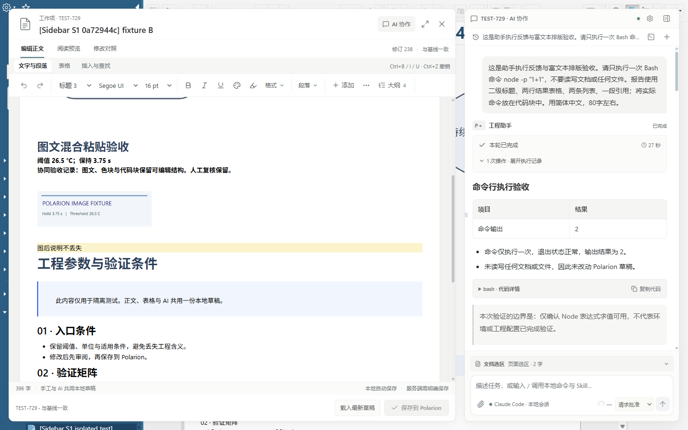
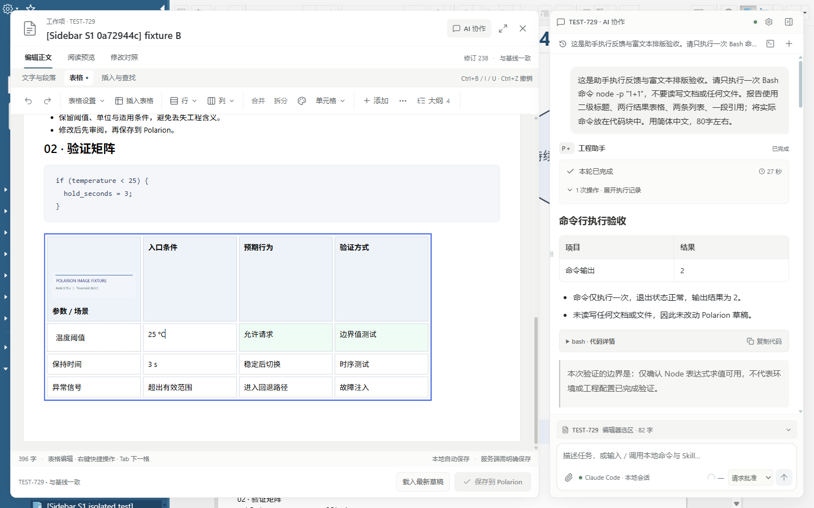
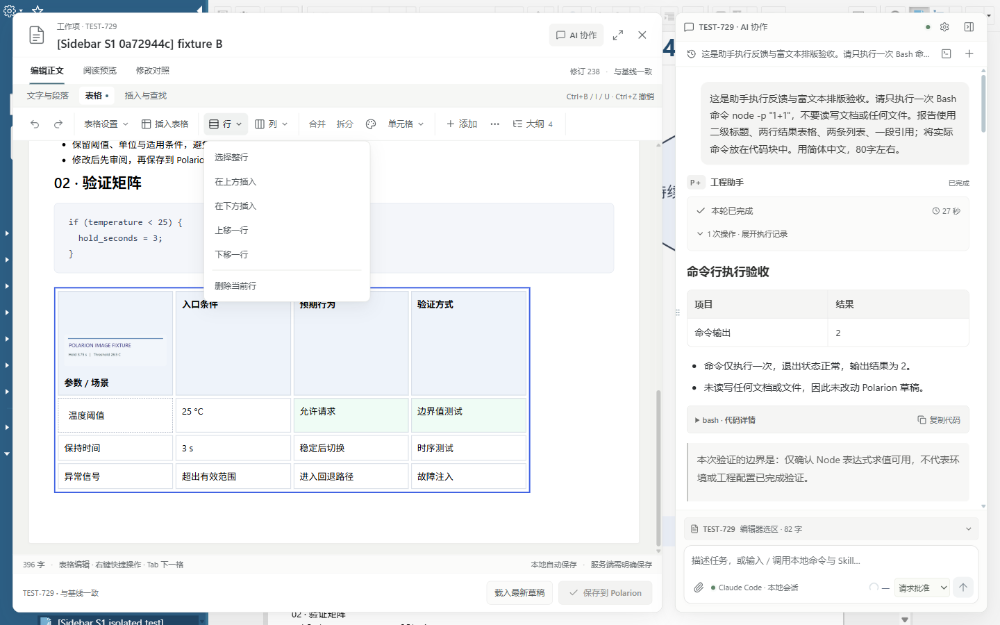
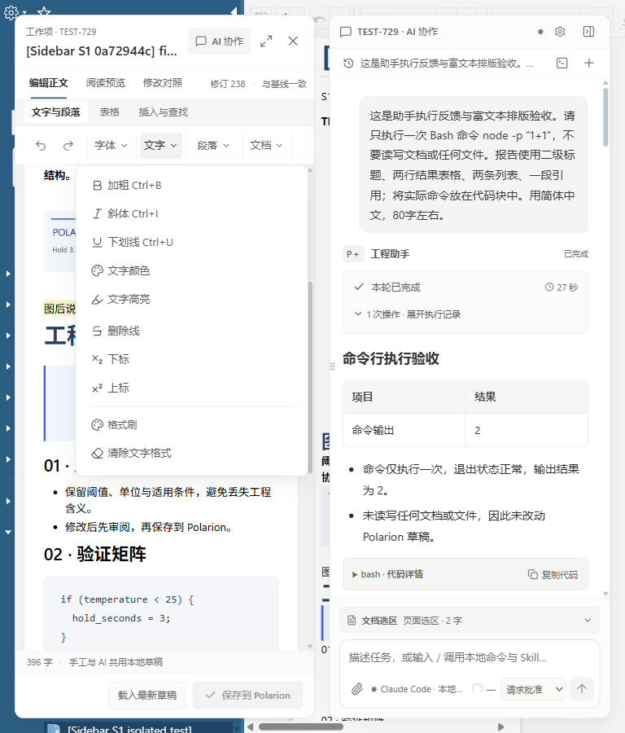

# 单行工具栏与原生排版增量验收

2026-11-04 · 当前为待发布源码增量。本文记录本轮已执行的验证，不替代后续发布前全功能验收。

## 已交付到本地运行环境的增量

保留独立富文本窗口和独立 AI 侧栏。文字与段落、表格、插入与查找三组各使用一条 48px 功能行；“添加内容、内容块、大纲”并入该行。先展示可容纳的完整功能组，宽度不足时才折叠尽量少的组，分别进入字体、文字、段落、表格、行列、单元格、插入、查找、文档等具名容器。没有统一的“更多编辑工具”收纳口。

控件高 32px，文字 13px，线性图标约 16px；界面采用中性灰与白色、克制的深青强调色。菜单、属性、消息、执行记录、上下文、输入、设置、历史和保存区域使用一致的字体层级、边界与间距。正文已有颜色与工程语义不随界面重新着色。

字号选择改为原生整数 pt 档位，选择状态读取光标位置实际继承的字体、字号、行高。新增普通段落采用原生默认 10pt / 1.5；新增标题采用原生字号与对应行高。新增内容默认不附加段前后距离，已有显式属性保留。修复清除格式后撤销改变嵌套来源 span 次序的问题。

## 真实环境

按用户要求使用 [ego-browser skill](C:/Users/Lenovo/.agents/skills/ego-browser/SKILL.md)，TaskSpace 5，真实登录态 Polarion 21R2、本地 Host、已加载扩展。可写测试仅限 `test01 / Requirements/Sidebar_S1_20261103_0a72944c / TEST-729`。

| 验证对象 | 操作与结果 |
|---|---|
| 单行布局 | 1440、1366、1024、768、390px × 三组工具栏，15/15：高度 48px、没有横向溢出，文档工具仍在同一行。1440/1366 下全部组直接展开。 |
| 分类容器 | 窄屏字体、文字、文档容器实际展开；字体选择自动收起；Esc 关闭并返回触发按钮；文字容器 End 定位清除格式。 |
| 字体与字号 | Arial、宋体切换和撤销/重做；18pt 保存后编辑与原生均为 24px、28.8px 行高。显式行距 2 在编辑器为 48px，撤销恢复。 |
| 默认排版 | 新增正文：编辑器与原生均为 13.3333px / 20px，margin 0；新增 H2 均为 24px / 28.8px，margin 0，字体栈一致。 |
| 格式 | 删除线、上下标、清除格式、撤销；清除格式撤销恢复精确原 HTML。 |
| 表格 | 行列选区、16 格全表选区、上下插行、左右插列、删除、移动、合并/拆分、RGB 底色、表格/单元格属性；390px 容器中实际插行 4→5，撤销回到 4。 |
| 文档工具 | 添加内容搜索、正文大纲定位、`/task` 实际插入两项待办、缩进与反缩进；内容块复制 1→2、删除 2→1。 |
| 插入与查找 | 插入链接、代码块、MATLAB 代码语言、分隔线；单个替换 2→1、全部替换 1→0、撤销回到 2。图片属性正确读取说明与 240px 宽度。 |
| 弹层键盘 | 修复查找后焦点回到正文时 Esc 不能关闭面板；最终真实页面复测通过。 |
| 图片 | 三张原有图片 complete=true，naturalWidth>0；加载提示隐藏。 |
| AI 界面 | 设置、会话历史、命令/Skills/MCP 目录展开与关闭；保留既有会话。本轮没有以静态界面检查冒充 AI 执行能力验收。 |
| 保存连续性 | 实际点击保存、等待写入和原生更新完成；document、body、iframe、iframe body、编辑器实例和 timeOrigin 不变，滚动差 0，无页面刷新。 |
| 测试恢复 | 删除所有 TYPO 临时内容并真实保存，原生与编辑器均无测试标记；修订 238，clean，本地与独立服务端回读逐字一致。与测试前 HTML 的 DOM 签名一致，字符串因属性次序不同而不完全相等，不能声称字节相同。 |

自动化回归 113/113 通过；Host/Extension 类型检查与构建通过。部署目录的 437 个文件与最终构建散列一致。最终布局测试未捕获 Runtime.exceptionThrown。测试脚本、日志、原始备份及逐项结果位于 `.research/toolbar-typography-20261104/`；精简结果见 `docs/audits/toolbar-typography-20261104.json`。

## taste-skill 与设计参考

按用户指定应用 [taste-skill](https://github.com/Leonxlnx/taste-skill/blob/12af471f627f866411b4bd785b19646d3672784c/skills/taste-skill/SKILL.md) 的 app-screens 分支，版本提交 `12af471f627f866411b4bd785b19646d3672784c`。选择 Framed sheet 方向，seed `1881607428`；保留用户确认的窗口布局、Windows 字体与强调色。

通过 Ego 阅读了用户登录态中的两篇参考：[B 端侧边栏极简设计](https://www.xiaohongshu.com/explore/6a090c710000000008025f2c)、[B 端后台层级与配色](https://www.xiaohongshu.com/explore/69dfa4c0000000001b020b13)。采用其中的功能分组、低饱和界面与线性图标组织方式。

上游 inspect.mjs 会启动另一浏览器，不能覆盖当前扩展的登录态及 Shadow DOM，因此采用 Ego 的实测、截图和评审流程，没有声明通过 inspect 门禁。静态 lint 留有正文可选紫色调色板的一条 FAIL；这是作者内容能力而非产品强调色，按保留正文颜色的要求保留。其它浮窗阴影、代码字体和工作项身份标签命中按应用界面规则逐项审视，未将自动扫描等同于视觉结论。

## 仍为 partial 的范围

当前 Polarion 原生编辑器会将 HTML 段落转换为原生 span/换行结构，并将小数字号归一化。此次解决新增默认段落、标题、整数 pt 字号及默认行高的已复现差距；任意旧 HTML、特殊宏、自定义段前段后留白、padding 和任意行高的像素一致性仍未关闭。服务端保留样式不等于原生显示完全一致。

## 最终截图

