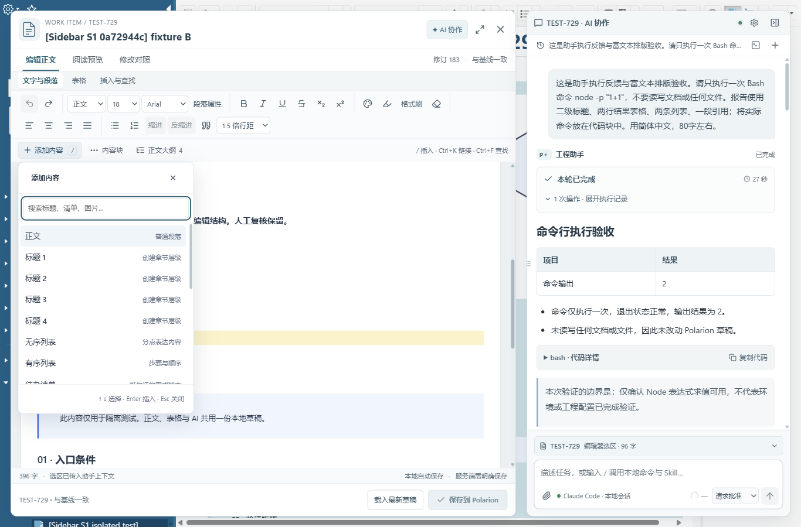
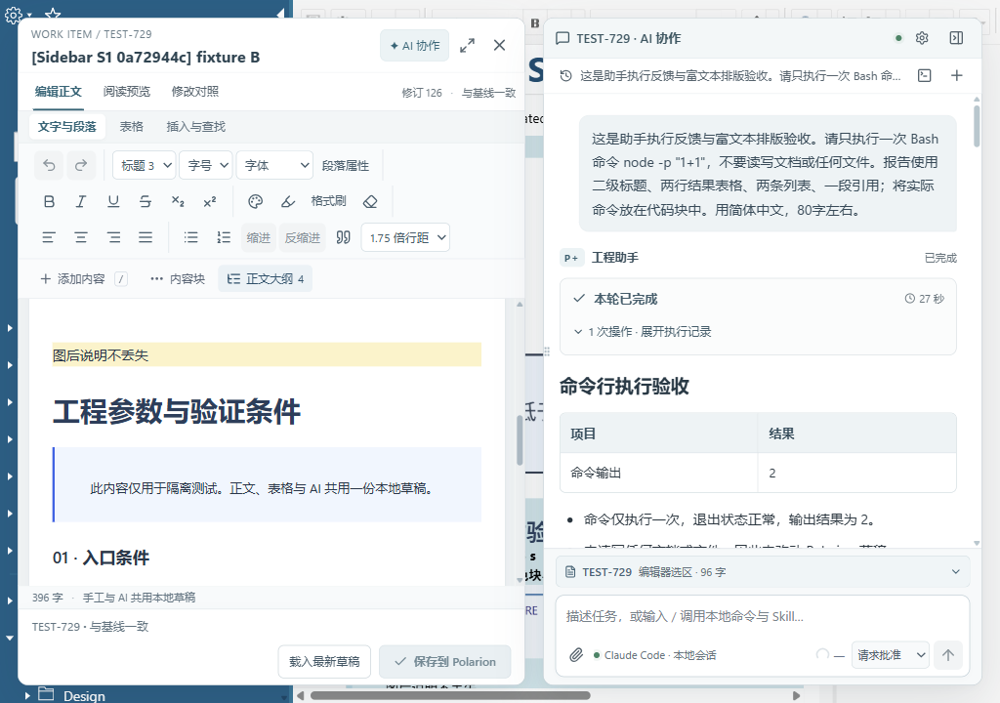
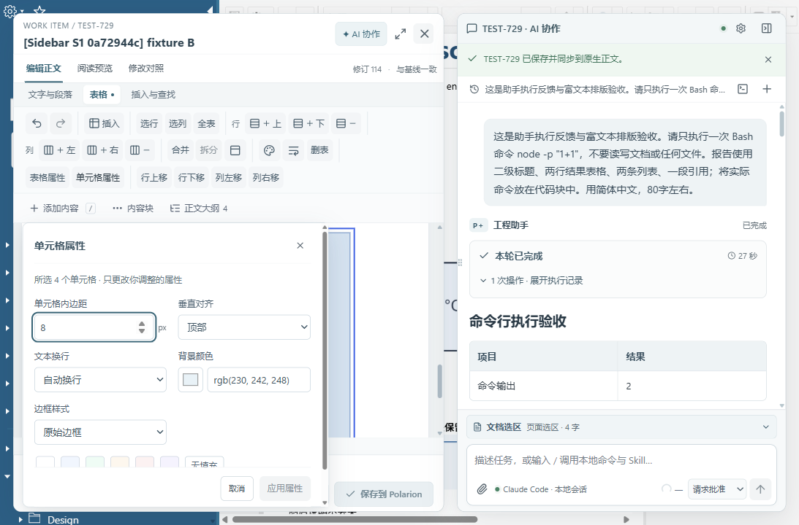

# 原版整体精修、富文本与免刷新保存验收

日期：2026-11-04（Asia/Shanghai）。源码版本：0.2.6 + 未发布增量。

后续增量已按用户新反馈将三组工具栏改为单行、并入文档工具并细化具名容器；本文“窄屏工具栏换行”是此前验收状态，现已被 [单行工具栏与原生排版验收](单行工具栏与原生排版验收_20261104.md) 覆盖。

本轮整体精修和新增编辑操作已在真实 Polarion 页面验收；免刷新保存及与原生编辑交替保存通过。字体、间距和颜色的服务端 HTML 保留通过，**任意原生格式的像素一致性仍为 partial**。本记录不将完整飞书功能、所有 Polarion 版本或三浏览器验收视为完成。

## 范围与运行环境

- 保留用户认可的原版：独立富文本浮窗、独立 AI 侧栏。没有恢复被否定的共享顶栏或合并窗口结构。
- 按用户要求，真实浏览器操作全部使用 [ego-browser skill](C:/Users/Lenovo/.agents/skills/ego-browser/SKILL.md)，TaskSpace 4；本地 Host、Native Messaging、已加载开发扩展和真实 Polarion 服务共同运行。
- 写入仅发生于 `test01 / Requirements/Sidebar_S1_20261103_0a72944c / TEST-729` 隔离夹具。没有把正式需求作为可写测试对象。
- 运行中的 Host 已更新；Chrome MV3 构建已部署到 `spikes/extension` 并实际激活。更新安装时重载过测试页；**保存验收期间不依赖页面重载**。
- 测试前保留原始 HTML；全部测试操作结束后通过界面恢复、保存，再独立读取服务端，确认与原始 HTML 完全相等。

## 实现

### 整体精修

统一系统中文字体、文字层级、灰蓝与青色配色、边框、焦点与按下状态、圆角和间距。覆盖主侧栏、大纲与属性、AI 消息和代码/表格、上下文卡片、输入区、设置、会话历史、命令/Skills/MCP 面板，以及编辑器标题、工具栏、菜单、属性、版本对照、状态栏和保存区。窄屏工具栏换行，正文独立滚动，底部保存入口保留。

### 文档编辑

- “添加内容”菜单与 `/` 快捷插入，支持中文、英文和拼音关键字搜索、方向键和 Enter。
- 正文、标题、无序/有序/待办列表、引用、三类提示块、代码块、分隔线，以及原有图片、表格、链接和工程画板入口。
- 待办勾选、Enter 拆分、Tab/Shift+Tab 层级；写回使用被动 HTML 标记，不依赖原生页面运行自定义脚本。
- 内容块上移、下移、复制、删除；正文标题大纲定位。复制清理来源身份，特殊宏保留保护。
- 查找高亮、前后导航、匹配数量、大小写选项、单个与全部替换；Ctrl+F/Ctrl+H，Ctrl+K 链接编辑。
- 图片按比例拖动缩放，尺寸提示和方向键尺寸调整；保留原有图片样式及居中属性。
- 表格右键就近操作、行/列/全表选区、插入/删除、合并/拆分；属性保留混合值提示、精确颜色、无填充和无效颜色拦截。

### 保存连续性

移除新保存流程的整页 reload。Host 独立回读确认写入后，使用当前已核验的 Polarion 21R2 原生读取及保存后状态接纳流程，更新原生文档模型、可见正文和修订基线。页面、iframe、body、富文本实例、AI 会话和撤销历史保持；滚动位置恢复。

仅刷新渲染内容会遗留旧修订基线，导致后续原生保存误报冲突。本轮已复现并修正，最终流程采用完整原生模型与相同修订的工作项内容。原生保存完成后也可以继续使用侧边栏，校验期间发生的输入或 DOM 变化不会被当作已保存内容接纳。

适配器当前严格匹配已核验的 21R2 GWT build `6CFA8B41DF5960703FD822D08642B011`。未匹配版本在发起远程保存前停止，不自动退回整页刷新。这里的免刷新指没有页面/iframe 导航，原生文档模型会在当前页面更新。

## 真实页面验收结果

| 项目 | 实际操作与结果 |
| --- | --- |
| 页面、编辑器与会话保留 | 实际点击“保存到 Polarion”，保存后 document、iframe、body、编辑器、AI 会话 DOM 身份及 performance.timeOrigin 均不变。 |
| 保存滚动位置 | 编辑区 scrollTop 保存前后均为 250px。 |
| 连续编辑与撤销 | 保存后继续修改、撤销并再次保存通过；Host 回归覆盖图片引用归一化后同一编辑会话继续保存。 |
| 与原生编辑交替保存 | 侧边栏保存后，在原生正文输入并点击原生保存，独立回读确认成功，无误报冲突；比较差异、保留本地、侧边栏再保存通过，未刷新页面。 |
| 重新载入与差异处理 | 发现并修正旧编辑器销毁后工具栏事件清理异常；载入最新草稿、保留本地并更新比较基线均实测正常。最终浏览器未捕获本扩展 Runtime.exceptionThrown。 |
| 内容插入 | 标题 4、无序/有序列表、引用、信息/备注/注意提示、代码块、分隔线，逐项插入并撤销。`/task` 搜索及 Enter 插入通过。 |
| 待办 | 勾选并真实保存后原生显示勾选状态；Enter 得到 2 项，Tab 得到 1 层嵌套，Shift+Tab 回到同级；撤销恢复。 |
| 内容块 | 复制后指定文字出现 2 次，上移、下移、删除复制块后回到 1 次；撤销恢复原始 HTML。 |
| 查找与链接 | 查找“阈值”显示 3 处，全部替换后剩余 0 处，撤销恢复；关闭查找面板后立即 Ctrl+K 设置链接成功。 |
| 大纲与键盘定位 | 4 个真实标题，点击定位；Ctrl+Home/Ctrl+End 定位编辑内容首尾。 |
| 图片缩放 | 真实鼠标拖动 760px → 660px，按比例高度约 305px；方向键 760px → 750px；撤销均回到 760px。 |
| 表格 | 真实 4×4 表格整行 4 格、整列 4 格、全表 16 格；上下插入行、左右插入列、删除行列、合并首行为 colspan=4、拆分及撤销通过。 |
| 精确颜色 | 无效颜色禁用应用；4 格设置 `rgb(230, 242, 248)` 后真实保存，原生 4 格计算色值与编辑器相同。 |
| 字体和段落数据 | 设置 Arial、18px、1.5 行距、段前 20px、段后 16px、RGB 底色，真实保存与独立回读一致，HTML 含所设值。原生显示差异见下节。 |
| 整体布局 | 真实页面 1366×900、1093×720、1024×720、1280×800 检查；1024 与 1280 下两个窗口不重叠、工具栏无横向溢出、保存按钮在视口内。设置、会话历史、能力面板展开通过。 |
| 最终清理 | 所有正文测试改动撤销并恢复原始 HTML；本地修订 183、clean，独立服务端读取与原始 HTML 完全相同。 |

自动化回归 **112/112 通过**；Host 与 Extension TypeScript 检查通过，构建通过，`git diff --check` 无错误。部署目录的 **437 个文件**与构建产物散列一致。没有把自动化检查当成真实工程验收的替代品。

精简结果：[frontend-richtext-20261104.json](audits/frontend-richtext-20261104.json)。逐轮 ego 脚本、原始备份与日志保留于 `.research/full-editor-20261103/`。

## 仍存在的原生显示差异

同一次实际保存中，服务端 HTML 保留 `font-size:18px` 和 Arial，编辑器计算字号为 18px、行高 27px；Polarion 原生编辑 DOM 转为 14pt，计算字号约 18.6667px、行高 28px。它还会改写段落为原生的 span/换行结构；20px/16px 段间距与背景保存在 HTML 中，但不能据此宣称原生编辑画面完全复现这些段落属性。

因此本轮关闭了已复现的颜色丢失、保存强制重载、旧修订误报冲突和编辑器销毁异常；**没有关闭任意旧正文、宏、字体及段落结构的像素级保真问题**。完整工作簿、公式/筛选/冻结行列、多人实时协作，以及完整飞书功能仍见既有总规格，未被此次增量替代。

## 飞书参考与边界

参考官方文档的功能组织与交互方式，没有操作用户的飞书内容：

- [/ 快速插入与内容缩写](https://www.feishu.cn/hc/zh-CN/articles/273504118179-快速插入支持的内容类型缩写)：行首或空格后的 `/`，通过中文、拼音、英文定位类型。
- [文档文本样式](https://www.feishu.cn/hc/zh-CN/articles/299406656534-在文档中设置文本样式)：就近格式工具与标题层级。
- [在文档中创建和管理任务](https://www.feishu.cn/hc/zh-CN/articles/545362352539-在文档中创建和管理任务)：待办入口和内容块组织；本轮清单没有接入飞书任务中心。
- [在文档中插入图片](https://www.feishu.cn/hc/zh-CN/articles/172132728301-在文档中插入图片)：图片插入与可视化编辑入口；本轮新增比例缩放，没有新增裁剪功能。

## 真实环境截图

